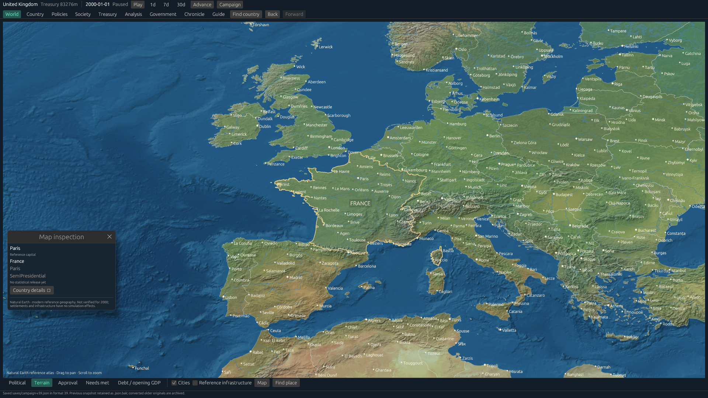

# Global map presentation

## Approved direction

The World screen is a fixed, north-up overhead atlas inspired by grand-strategy
cartography. Shaded terrain, restrained political tints, thin borders and
zoom-dependent settlement labels provide geographic detail. Compact controls and
a closable inspector leave the map central. No camera tilt or rotation is planned.

## Implementation contract

The desktop remains Rust/eframe/wgpu. Display-only geographic identities are
separate from simulation countries and sovereign authority. Reference countries
outside a scenario have no fabricated reports or government actions. Reference
infrastructure defaults off and is neither transport simulation nor verified
year-2000 geography. All layers preserve source attribution and temporal limits.

The offline compiler pins Natural Earth inputs, records checksums and produces
versioned assets: terrain tiles, country meshes, three vector detail levels,
settlements, hydrology and generalized infrastructure. Terrain tiles have mipmaps
and edge gutters. Packaged assets must remain below 250 MB; the runtime requires
no network. Missing assets retain the simplified-map fallback with a diagnostic.
The intended tile-cache bounds are 128 MiB GPU and 64 MiB decoded CPU memory.

World-scale labels prioritize countries; regional zoom adds capitals and major
cities; closer zoom adds further settlements and optional reference urban areas,
roads and railways. Label collision rejection takes priority over completeness.

## Interface

The campaign map fills its central viewport without outer scrolling or permanent
navigation sidebar. A compact national/date/playback bar and ministry navigation
remain visible. Country search and file controls move to menus. One inspector
shows the selected country or settlement; analytical screens retain full width.
Map modes are Political, Terrain, Approval, Needs and Debt. Terrain is the default.
Navigation history preserves the camera, layers and reference selection.

## Acceptance and evidence

Validate reproducible assets, input checksums, holes, islands, shared borders,
antimeridian geometry, tile seams and missing assets. Exercise pan/zoom, picking,
reference-only inspectors, keyboard ownership and history without changing
campaign bytes. Inspect global regions at 1280×800, 1920×1080 and scaled 4K.
Record asset/cache sizes and frame times with hardware/backend identification;
60 FPS is a hardware-baseline target, not a software-renderer promise.

Run the standard repository validator and distinguish Linux native evidence from
other-platform CI. Update [development progress](development-progress.md) with
actual results. Existing requirement IDs/statuses remain authoritative in the
[register](implementation-register.csv); visual infrastructure does not complete
transport or economic simulation requirements.

## Current implementation and reproduction

The global atlas is implemented with 258 reference features and 7,325 settlements.
The packaged assets total approximately 80.3 MB. Sources, compiler dependencies,
rebuild commands and historical limits are documented in [data notes](../data/README.md).
Five raster pyramid levels have 512-pixel interiors and one-pixel gutters; runtime
mipmaps are decoded off-thread. Three country mesh levels use shared-coverage
simplification. Per-country colors use a fixed uniform palette compatible with
eframe's default GPU limits. Borders, labels and reference lines are clipped CPU
presentation overlays; country geometry and terrain use the custom GPU callback.

The World screen uses the new map during an active campaign. Initial mandate
setup and the full country analytical screen retain the existing overview.
The bottom Map menu retains water/division search and provenance; Find place
searches global reference countries and settlements. A selected settlement or
reference country opens a closable inspector. Treasury in the HUD uses current
owned reporting credits; needs/approval retain their public release date.

Run `STATECRAFT_MAP_BENCHMARK=1` with the native desktop and begin a paused
campaign to measure the same 420-frame Europe/Asia/America/Pacific route (60 warmup
frames, 360 measured intervals). It logs adapter identity, frame-interval p50/p95,
and bounded tile-cache occupancy. The benchmark changes presentation only.
Native evidence and remaining limitations are recorded in [map validation](map-validation.md)
and development progress.

