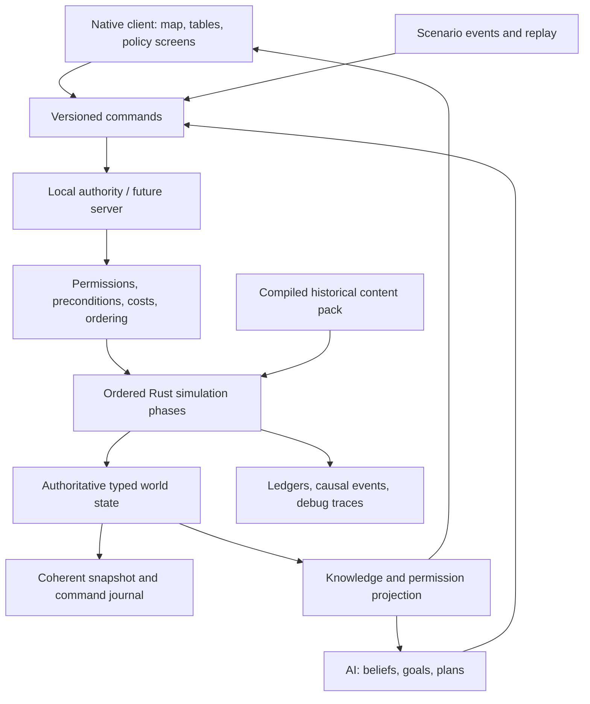

# Technical research and architecture recommendation

Research date: 2 November 2026. Primary-source documentation was checked live. Recommendations and performance targets below are engineering judgments, not measured results or promises by the dependencies. Companion to the [ordered implementation list](implementation-order.md) and [world-data specification](world-data-specification.md); no delivery schedule or workload estimate is intended.

## Recommended decision

Build a standalone deterministic Rust simulation library, a native desktop client using **egui/eframe with the wgpu backend**, and an offline world-data compiler. Render the map through a custom wgpu paint callback using prebuilt vector meshes. Start persistence with **bundled SQLite through rusqlite**, while evaluating **Turso Database, formerly Limbo**, against the same persistence contract. Keep an explicit exit gate for moving the presentation shell to Bevy if the first map/UI prototype proves that game-engine services justify its additional integration surface.

For a solo developer assisted by AI, a map-and-dense-interface game benefits more from strong data tooling, a testable simulation and fast interface iteration than from starting with a general-purpose 3D engine. This choice does not mean building a renderer or GUI toolkit from scratch: eframe supplies the application integration, egui supplies widgets, and wgpu supplies the GPU abstraction. Native desktop, offline play and all three requested operating systems are first-class acceptance requirements.

### Technology decision table

| Area | Recommended starting point | Alternatives and decision rationale |
|---|---|---|
| Authoritative simulation | Independent Rust crate with typed IDs, indexed stores and explicit phases | Bevy ECS may be used internally if measured benefits justify it, but no render resources, OS clock or GUI objects belong in game rules. |
| Desktop shell and dense UI | egui + eframe + wgpu | Direct winit + egui is a later escape hatch if eframe blocks required control. Iced is a credible Elm-style application framework, but switching from an egui prototype must demonstrate a concrete improvement in keyboard behavior, text, styling or layout. |
| Game-engine alternative | Bevy for presentation if the prototype needs its asset, audio, animation and scene ecosystem | Bevy officially supplies 2D/3D rendering, asset hot reload, ECS, audio and desktop platform support. Its default system execution is not deterministic. A Bevy dependency does not solve deterministic simulation automatically. |
| Map graphics | Offline polygon triangulation and LOD meshes, custom wgpu pipeline | Lyon turns paths into triangle meshes. Retain topology and geographic source geometry separately from display geometry. Do not parse and retessellate the world SVG each frame. |
| SVG icons/illustrations | SVG masters; resvg-generated textures or geometry cached by scale | resvg renders static SVG. Use it for imported artwork, not as the entire interactive map runtime. |
| More elaborate vector graphics | Evaluate Vello only on a demonstrated need | Current upstream distinguishes CPU, GPU and experimental compute implementations with different maturity profiles. Broadly saying “Vello is stable” or “Vello is experimental” loses that distinction. Static map geometry does not require a general dynamic vector renderer. |
| Content queries and saves | rusqlite with bundled SQLite | This intentionally includes C SQLite inside a Rust application. Bundling avoids depending on a different system SQLite on every player machine. |
| Pure-Rust SQL candidate | Turso behind a narrow persistence adapter | Current upstream says it is used in production, so old “Limbo alpha, not production ready” claims are obsolete. Its compatibility and workload behavior still need testing for this application. |
| Multiplayer | Authoritative host/server, validated command protocol, filtered state replication | Begin with a local authority implementing the same command boundary. Do not default to peer lockstep because hidden information, late joining and divergent machines create substantial extra constraints. |
| AI | Budgeted, inspectable utility scoring plus hierarchical plans and explicit constraints | No live LLM service in the authoritative tick. Optional generated flavor text should consume established events and never mutate world truth. |

Official foundation sources: [egui repository](https://github.com/emilk/egui), [egui architecture](https://github.com/emilk/egui/blob/main/ARCHITECTURE.md), [Iced](https://github.com/iced-rs/iced), [Bevy features](https://bevy.org/), [wgpu backends](https://wgpu.rs/doc/wgpu/documentation/features/index.html), [Lyon](https://github.com/nical/lyon), [resvg](https://github.com/linebender/resvg), [Vello renderer choices](https://github.com/linebender/vello/blob/main/README.md?plain=1), [rusqlite](https://github.com/rusqlite/rusqlite), [Turso](https://github.com/tursodatabase/turso).

### Implemented administrative reference layer

The desktop [administrative atlas](../crates/desktop/src/administrative.rs) shares an immutable `Arc` cache of 726 Natural Earth v3.3.0 reference areas across the fifteen starter countries. The [offline compiler](../scripts/import_administrative_geometry.py) verifies four pinned original-file checksums, explicit UTF-8 encoding and WGS84 coordinates, preserving source `ADM1_CODE` identities, separate polygon parts and holes. DBF row numbers remain provenance only. Eight records with no source name or type stay explicitly unnamed; the [manifest](../data/administrative-references-manifest.json) records coverage, transformations and historical limitations.

Search accepts attributed names, aliases, country names and source IDs; unique confirmation focuses the selected country's division. Boundary drawing culls polygon bounds against the viewport and displays the inspected country's areas. Hit tests account for holes and both dateline parts; dateline-spanning focus uses the largest contiguous part. Country-level dated public overlays and player authority keep their existing boundaries. These display references do not create simulated regions, administrative powers, local statistics or historical sovereignty claims. Scenario jurisdictions remain separate. Priority 4 remains partial.

### Implemented inspection navigation

The native [history](../crates/desktop/src/navigation.rs) retains at most 64 presentation visits, using typed country/policy identities and a lightweight [map view](../crates/desktop/src/map.rs). It stores no `World`, private projection, geometry cache or accepted command. Screen/country/policy/reference-mode changes create visits; camera/layer changes and draft edits update the current visit. Back/Forward restores presentation state only. Loading, recovery and new campaigns discard history; invalid replacements retain it. Text editors, open popups and campaign/recovery dialogs retain keyboard ownership. Existing per-screen/country scroll IDs continue to retain scroll context independently. Individual panel queries and programme focus are not versioned by this history.

### Bookmark reference index

The native [reference index](../crates/desktop/src/help.rs) reads immutable `Content`, with no `World` argument. Party records retain opening labels/seats; active office terms and explicitly listed collective members determine person-reference roles at `content.start`, not the campaign date. Stable country/party/person/office/term identities remain searchable; destinations derive from typed country/office relationships rather than display names or row positions. Vacancy, absent incumbency, unknown collective membership, validity endpoints and source qualities remain distinct. Latin-accent/macron folding changes only lookup keys. The editor retains ownership through Enter and click-to-clear; related-screen navigation changes presentation context only. Live projections continue through the existing government/observer boundary.

## Architecture boundaries

Suggested workspace modules:

- `sim-types`: IDs, units, dates, numeric conventions, public commands and results.
- `sim-core`: authoritative world state and ordered stepping; runs without a display, database or network.
- `sim-economy`, `sim-politics`, `sim-diplomacy`, `sim-conflict`, `sim-society`: domain behavior, joined through explicit phase inputs and outputs rather than arbitrary cross-module mutation.
- `sim-ai`: observations, preferences, planning, command production and decision explanations.
- `content-schema`: versioned definitions for policies, institutions, events, technologies, parties and scenarios.
- `content-build`: offline import, normalization, validation, source attribution and reproducible content-pack compilation.
- `persistence`: snapshots, command journals, migrations, content hashes and save integrity.
- `protocol`: transport-independent command envelope and replicated views.
- `client`: navigation, widgets, charts, audio and OS interaction.
- `map-render`: map layers, picking, labels, cameras and display-only interpolation.
- `headless`: scenario runner, AI tournaments, replay verification and benchmark executable.

The UI reads immutable, purpose-built views. A click creates a command; a command is validated by the authority; accepted commands become ordered simulation input. Never let a policy slider directly edit a shared `World`. Preview calculations run against an explicit snapshot or a pure forecast model and expose their assumptions.

Keep normal build/test iteration small: domain crates should compile and test without the GPU stack. Avoid splitting every small concept into a crate; the list describes boundaries, and related domains can initially share a crate. Do not build microservices for a desktop game.

### Command identity in the implemented authority

`CommandId` is a distinct campaign-global reference in envelopes, the allocator, receipts, programme proposal history, fiscal programme dispatch and cash-release records. It remains a transparent JSON number in every supported rules/save version; request and project IDs retain their own types. Store boundaries explicitly derive a request's numeric key from its issuing command. Sequence advancement stays checked, and existing authority rejects zero, stale, duplicate or out-of-order incoming IDs. A zero query boundary means before any commands; it is not an issued identity. A typed `journal_entry` lookup resolves host journal records, rejects absent/zero references and verifies stored identity; walkthrough and fiscal dispatch callers use that store method. Public display and diagnostic formatting retain the original numbers. [Identity contracts](../crates/sim-core/src/ids.rs) reject cross-family assignments at compile time; [campaign checks](../crates/sim-core/tests/command_identities.rs) protect pre-change hashes and links through cash release and reviewed budget dispatch.

### Elapsed time at stepping boundaries

The implemented `World::advance` boundary takes `DaySpan`, and `advance_to_event` returns that elapsed unit rather than an absolute day index. Native worker requests, manual/date/automatic controls and walkthrough navigation carry the same type. Terminal day counts and target-date differences convert explicitly at input boundaries; replay uses explicit one-day spans. Simulation dates, limits, daily phase order, partial-step rollback and serialized clock fields retain their existing representation and behavior. This is a Rust API change, not a campaign conversion. [Compile-time contracts](../crates/sim-core/src/rules.rs), [elapsed event regression](../crates/sim-core/tests/elapsed_time.rs) and the native worker's nonzero-bookmark test distinguish duration from destination. Configured durations are extended below; other stored time/rate fields remain primitive, and P01-03 remains partial.

### Authoritative campaign clock

`World.day` now carries [`CampaignDay`](../crates/sim-core/src/campaign_clock.rs), an absolute position on the existing calendar. `checked_add(DaySpan)` composes a checked future position; `elapsed_since` returns a checked elapsed span. Daily ticks and next-event stepping use those operations. Legacy due-date records, calendar queries, formula inputs and client displays explicitly extract the preceding numeric index; this does not yet type every stored timestamp.

Transparent numeric JSON and the original numeric diagnostics preserve content identities, canonical hashes and every existing snapshot format. The module's unit check covers numeric encoding, invalid input, overflow and elapsed composition at a nonzero epoch. Compile-fail contracts prohibit assigning elapsed time or an untyped count to the authoritative clock. Existing calendar, transaction, stepping and replay checks retain the preceding phase order and bounds. P01-03 remains partial for remaining timestamp, percentage, currency and physical-unit coverage.

### Configured durations and policy schedules

Configured construction, consent, leadership review, loan maturity, cooldown, election, fiscal, territorial, subnational, undertaking and cash-protection periods now use `DaySpan`. Income annualisation and reserve-contract duration use the same elapsed unit. Policy and financing previews carry typed delays, as do cabinet preparation results; the recovery runner passes those directly to `advance`. Absolute proposal, decision, due and expiry dates remain calendar indices and explicitly extract elapsed units only when calculating a destination. Stock coverage in days and calendar-year mandate counts remain separate quantities.

Policy construction and amendments compose checked spans before adding them to a date. Cabinet preparation scales a duration with a wide intermediate and one downward rounding; zero denominators and unrepresentable results are refused. Transparent numeric JSON, original numeric diagnostics, all pack hashes and campaign formats remain unchanged. The normal content validation still enforces each procedure's specific range. [Configured-duration checks](../crates/sim-core/tests/configured_durations.rs) protect captured content/pending/delivery hashes, reservation dates, resume/replay, scaling boundaries and invalid input. Compile-fail contracts on government consent, loan maturity and policy previews prevent rate/date substitution. This advances P01-03 without completing remaining rate, calendar, currency and physical-unit coverage.

### Requested elapsed periods in commands

Temporary cash-retention and regional service-grant requests carry `DaySpan` in `Action::HoldCash` and `RegionalOrderKind::Grant`, including stored command journals and regional orders. Cash previews and authority retain that type. Native controls, terminal parsing and AI construct the elapsed span at their input boundaries; the shared command rules enforce the same original duration limits. Cash expiry extracts the elapsed count when checking a calendar destination. Grant scheduling retains the inclusive final payment day, with one explicitly extracted day subtracted from the funded period.

Numeric JSON, debug output, paid administration, escrow, daily payments and all published campaign formats remain unchanged. [Requested-duration checks](../crates/sim-core/tests/action_durations.rs) protect atomic refusal of invalid spans, protected cash, grant payments and captured day-0/day-14/day-44 hashes through exact resume/replay. Compile-fail contracts distinguish a date or basis-point rate from the requested period. Stock coverage retains its separate physical-quantity meaning; broader percentage, calendar and physical/currency coverage remains unfinished under P01-03.

### Physical stock coverage

`NeedDays` represents multiples of a commodity's baseline daily physical requirement. It now types working-inventory ceilings, national reserve capacity and AI targets, retained order quantities and `Action::ProcureReserve` requests, including reserve preview/authority boundaries. Native controls and terminal inputs construct that quantity explicitly. Consent and contract periods carry `DaySpan`; a quoted stock quantity preserves its existing delivery schedule and finite import/cash constraints.

Explicit count extraction at physical multiplication and range-check boundaries preserves all preceding bounds and integer rounding. Transparent numeric JSON, numeric diagnostics and every existing content/snapshot format remain unchanged. [Stock-coverage checks](../crates/sim-core/tests/stock_coverage.rs) protect invalid input, atomic quantity refusal, actual fees/reservations/stock and captured pending/partial/completed hashes through exact resume/replay. Compile-fail contracts distinguish inventory coverage from elapsed time and basis-point rates. Percentage settings, calendar indices and broader physical/currency coverage remain unfinished under P01-03.

### Basis-point fields and ratios

Basis-point configuration and live records now retain `BasisPoints` rather than bare signed/unsigned counts. This includes authored GDP costs, fees, financing rates, tax-band thresholds/multipliers, market indices and limits, regional shares/entitlements and reserve prices. Reported preference distances/coverage and group-mean Gini use the same normalized ratio unit; unknown values stay absent. Public marginal-tax and next-market-price calculations carry that unit across their boundaries. Percent counts and calendar days cannot silently become basis-point fields.

The existing positive scalar JSON and per-procedure ranges remain unchanged. Negative or unrepresentable external values fail before they can enter a rate field. Numeric formatting and explicit unsigned/signed extraction preserve the existing bounded arithmetic and every legacy rounding point; this does not combine previously separate fee calculations or recalibrate policy costs. [Configured-rate checks](../crates/sim-core/tests/configured_rates.rs) protect numeric encoding, invalid input, actual paid appointment/amendment/loan controls, pending dates and the pre-change day-14/day-200 hashes through resume/replay. Compile-fail contracts distinguish cash, percent counts and calendar days from rates. Percentage-valued settings, calendar indices and broader physical/currency coverage remain unfinished under P01-03.

### Opening percentages and annual GDP

`CountryDefinition` carries `Percent` for opening tax, service/welfare spending, food/energy capacity, administration and approval. Field-specific limits retain production above 100% where previously permitted. `AnnualGdp` carries the nonnegative annual monetary calibration through country definitions and regional/reserve cost helpers; it is distinct from spendable `Money`. Explicit extraction preserves existing arithmetic, rounding, signed live fields and displays. Numeric JSON and diagnostics retain all content identities and snapshot representations. [Opening-percentage checks](../crates/sim-core/tests/opening_percentages.rs), [annual-GDP checks](../crates/sim-core/tests/annual_gdp.rs) and compile-fail contracts protect these boundaries. Remaining percentages, timestamps, currency and physical dimensions keep P01-03 partial.

### Typed population across content and live state

`CountryDefinition::population` uses the same transparent `Population` type as live country/cohort counts and public reports. Initialization transfers that typed value directly; world and reserve checks compare population units. Fact validation, cohort partition inputs, income-tax ratios and client number formatting explicitly extract the scalar count at their numerical boundaries. Existing unsigned JSON numbers, source bounds, integer partitions, wide intermediate arithmetic and rounding remain unchanged. [Compile-time contracts](../crates/sim-core/src/model.rs) reject money and implicit raw-count substitution; [regressions](../crates/sim-core/tests/population_units.rs) preserve all twenty-three content/opening hashes and an uneven-census day-61 progression. Broader unit coverage remains P01-03.

## Simulation cadence and determinism

Use an integer simulation clock. A proposed baseline is an hourly command/event boundary, daily operational and market settlement, weekly strategic AI reviews, and monthly demographic, fiscal reporting and structural updates. These are design starting points; calibration must determine whether batching creates implausible jumps. A long construction project should track continuous progress rather than suddenly existing on a month boundary.

Display interpolation and camera animation use render time. Game speed controls how many simulation steps run; it must not alter formulas or cause “missed” ticks. AI decision budgets should count candidate evaluations or planning expansions, not elapsed milliseconds, if the same replay is expected to reproduce its choices.

Determinism requirements:

1. Fixed phase order and explicit dependency graph.
2. Stable IDs independent of memory location, ECS allocation and language hash-map randomization.
3. Stable sorting before any order-sensitive conflict resolution or reduction.
4. Integer or fixed-point representations for money, population counts, quantities and policy parameters where feasible; declared scales, rounding and overflow behavior. Use wider intermediate arithmetic and test boundary ranges.
5. Explicitly controlled floating-point calculations where unavoidable. Do not assume “Rust” guarantees cross-platform identical math. Keep GPU math out of authoritative rules.
6. A versioned named PRNG and independent deterministic streams by subsystem or actor. Persist seeds and counters. Avoid changing all political events because a visual particle consumed a random number.
7. Parallel workers produce isolated proposals or deltas, which the authority commits in stable order. Thread completion order cannot determine world events.
8. Replay input includes simulation version, content hash, mod order, settings, seed and ordered commands. Changing rules can intentionally invalidate old replays; be explicit about that support policy.
9. Canonical per-subsystem hashes and an inspectable first-divergence dump in the headless runner.

Bevy's [FixedUpdate](https://docs.rs/bevy/latest/bevy/app/struct.FixedUpdate.html) separates fixed logic from rendering, while its [system documentation](https://docs.rs/bevy/latest/bevy/ecs/system/index.html) explicitly describes default execution as parallel and nondeterministic. FixedUpdate alone is therefore insufficient. [rand_chacha](https://docs.rs/rand_chacha/latest/rand_chacha/) documents deterministic portable generators; pin the generator and its surrounding sampling algorithms rather than assuming every dependency update preserves all samples.

### Implemented daily dependency order

The current authority runs one complete country pass in ascending `CountryId` order, then a monthly AI pass over that same order. This is an explicit sequential dependency chain, not a parallel system scheduler:

1. Increment the absolute daily clock. For fiscal-plan content, close the previous fiscal year before January decisions or payments.
2. Notice technology/statutory proposal dates; resolve cash holds, constitutional decisions and statutory consent/implementation; reconcile undertakings and territorial succession/reviews.
3. Synchronize electoral mandates, resolve election requests, regional orders, cabinet appointments and budget bills, then policy consent and borrowing.
4. Complete due projects, review reserves, settle production/households/fiscal flows, then evaluate commitments and undertakings. Legacy content without fiscal plans closes its budget after settlement.
5. Resolve due political/electoral/leadership reviews and reconcile the resulting mandates, succession, statutory bill sponsorship and cash holds.
6. After every country has settled, run monthly foreign-government AI in stable country order. Retain the ledger window and perform the one-time campaign review afterward.

The only implemented stochastic subsystem is supply disruption. Its `supply-v2` stream uses FNV-1a-64 on the exact UTF-8 key with decimal seed/period fields `{seed}:{country_id}:{period}:supply-v2`; `period = (absolute_day - 1) / 90` for settlement days starting at one. A sample divisible by three causes a `10 + sample % 16` capacity reduction on the first twenty days of that period. Seed and absolute day are saved, so the period index is reconstructed without a mutable cursor. Adding another country or rendering a frame consumes no supply samples. This hash-derived sampler is not a general-purpose statistical PRNG; future stochastic domains must define separately versioned stream keys and sampling rules. Changes to either mapping or distribution require an explicit rules-version compatibility decision. [Pinned vectors and roster/resume tests](../crates/sim-core/tests/random_streams.rs) protect the current contract; [sampling implementation](../crates/sim-core/src/random.rs) contains additional fixed vectors.

### Versioned political selection

Rules 24 order nonincumbent parties by stable `PartyId` before distributing the 100-seat model's integer remainders. The successor coalition's largest party leads; equal seat totals prefer the lowest ID, and new successor coalitions list their members in the same canonical order. Display names and input row order do not settle these choices. Remainder division uses the actual collection count without narrowing it to a seat-sized integer. Earlier rules preserve their published row order and last-encountered equal-seat leader; changing those old algorithms would invalidate existing replays.

The new historical starter preserves every preceding country/party definition and resource parameter. The fictional fixture adds one explicitly authored party with unknown fiscal preferences. Snapshot 25 distinguishes the new political semantics even though the world field layout remains compatible; rules 24 reject older envelope numbers. [Ordering tests](../crates/sim-core/tests/stable_elections.rs) reproduce permutations and ties and preserve exact old counterexamples. [Starter/recovery tests](../crates/sim-core/tests/stable_elections_starter.rs) verify old pack identities and backups alongside its preserved starter. The model remains an authored approximation rather than an implementation of national electoral law.

## Persistence: SQL is storage, not the inner game loop

Load normalized scenario data into typed in-memory state. Avoid querying SQL separately for every country, market, household or military unit on every tick. Tables are useful for the content compiler, scenario editor, debugging queries, historical series and durable save metadata. Dense arrays and indexed stores are generally a better starting point for hot simulation loops.

Suggested save package: manifest, versioned world snapshot, recent command journal, compressed historical series, content/mod manifest and integrity hashes. A single SQLite container is possible, but is not mandatory. Do not confuse a database's physical file compatibility with a durable application save schema.

Save on a coherent tick boundary. Copy or version the snapshot, write on a background worker, then commit/rename atomically as appropriate for the selected format. Retain a rotating previous autosave. Test interrupted writes, damaged files, missing mods and schema migrations. Never rely on copying a live database file while ignoring its journal or WAL. Use the database's supported backup/checkpoint approach if saves are database copies.

Turso evaluation gates: required SQL features and constraints; file interoperability if promised; transactions and crash recovery; durability under interrupted writes; prepared statements; platform packaging; content import throughput; long campaign history growth; migration tool support; and real save/load latency. Upstream now states that Turso is a production database and that libSQL has been battle-tested longer. Treat the choice as workload validation, not a referendum on whether a Rust rewrite is legitimate. [Turso official FAQ](https://github.com/tursodatabase/turso). rusqlite's bundled feature compiles a fixed SQLite library as part of the application. [rusqlite build documentation](https://github.com/rusqlite/rusqlite).

## Multiplayer preparation without building multiplayer first

Single-player starts an in-process authority. The future server runs the same simulation with no renderer. Humans, AI, replay playback and scenario scripts all issue commands through the same validation boundary. Commands carry a unique ID, actor/role identity, intended tick, payload version and preconditions. The authority assigns order, rejects invalid actions and handles duplicate delivery idempotently.

Replicate only the information that each player is entitled to know. Separate the actual world, actor beliefs and the player's public view from the beginning. Sending a full world snapshot to every client and hiding secret intelligence in the UI is insufficient for competitive multiplayer.

Prepare protocol versioning, content/mod checksums, save-and-resume, reconnect snapshots plus subsequent deltas, spectator views, speed/pause ownership, AI takeover and country co-op roles. Transport selection, account services, matchmaking, NAT traversal, relay services, Steam integration and anti-cheat remain a later project. A deterministic core remains valuable for debugging even if clients never simulate the whole authoritative world.

Before promising multiplayer readiness, test two local clients with independent render rates and injected command delay. Verify identical validated results, no duplicate purchases, no future-state leaks, recovery from disconnect and rejection of a modified content manifest. Implement the seam now; defer the product surface.

### Implemented command and knowledge boundaries

`World::execute` accepts the current command envelope (`id`, `day`, `issuer`, `action`); `World::issue` constructs it for the controlled government. Desktop actions and terminal scripts use this authority. AI, reviewed budget dispatch and replay reach the same internal dispatcher through trusted origins that are not fields of incoming commands. Stale/duplicate IDs or days, foreign issuers, wrong content and failed action conditions are rejected before acceptance. The current reference-enabled rules roll back failed commands, including event-allocation failures. Developer commands require a separate trusted host path, validate their bounds and permanently mark the campaign.

`execute_with_receipt` and `issue_with_receipt` return an ephemeral `CommandReceipt` containing the accepted command number and its retained immediate `EventId` outcomes. Reference-enabled commands must record an outcome before entering the accepted-command journal. Native status and terminal replies identify those outcomes for Chronicle lookup. Acceptance of a proposal does not certify later consent, funding or delivery; older campaigns retain their original event text without invented references. Receipts are derived responses, not additional saved state or access grants.

`World::project` supplies a government with its own private country/events plus public reports for the roster. Observers receive only public reports. Statistical releases retain their actual dates; opening absence remains unknown, and live foreign balances, cohorts, pending requests, execution, event streams and AI plans are excluded. Legal public appointments/decisions and approved fiscal-setting history are exposed by their dedicated published types. Map overlays and ordinary public charts/comparisons consume those reports; treasury history is restricted to the controlled government. Current AI heuristics read their own government's state. Richer beliefs, census error and intelligence remain later systems. The trusted host assigns `Viewer`; projection minimizes data and does not authenticate a network session. Networking, account roles and replicated transports remain Priority 41.

### Implemented replay and AI evidence

[`replay_trace`](../crates/sim-core/src/replay_trace.rs) observes the shared replay driver at opening, completed daily ticks and accepted manual/developer commands. Version-1 JSONL sidecars contain canonical world and country/domain component hashes, with explicitly sorted object keys and unchanged array order. They are streamed separately from campaign saves. Input identity includes content/rules, seed, player, scenario, time range and manual-input identity; snapshot agreement and failed execution outcomes remain separate. The bounded reader checks chronology, sequence, component ordering and completion. Comparison checks the whole evidence stream and reports its first differing boundary/components, including transient differences whose final hashes agree. A reference must have been captured before the compared engine change; a final snapshot alone cannot establish the earliest divergence. Ordinary replay retains command and final-state validation.

[`ai_inspection`](../crates/sim-core/src/ai_inspection.rs) borrows accepted automated journal entries and retained AI review messages for one country. It reports totals, newest-first bounded collections and reviewed-budget dispatch origin without inventing scores, missing explanations or command/event associations. The player-controlled country is labelled. Both interfaces are restricted to the explicit developer host and leave world hashes and certification unchanged. Normal government projections retain their privacy boundary. These refine the existing command audit, private transfer ledger and country/AI events; future systems require their own evidence.

### Authored statutory authority

[`legislation`](../crates/sim-core/src/legislation.rs) defines stable law/bill IDs, attributed date/country availability and target-dependent policy prerequisites in rules/content 26, also retained by the integrated rules-28 default. A proposal uses the current governing route, pays drafting administration from actual uncommitted cash and protects the remaining implementation cost. Current backing is rechecked at consent; implementation pays the protected cost before recording enacted permission. Withdrawal, refusal or sponsoring-government succession releases only unspent funds. Paid work and cooldowns persist, while enacted statutes survive government succession. Adoption itself changes no production, services or treasury credit.

Policy commissioning, commitment amendment and changed fiscal targets enforce the same prerequisite. Stored programme commands and budget proposals validate permission at their original dates. Campaign-day dates, elapsed periods, annual-GDP calibration and basis-point costs retain their distinct types. January closes preceding fiscal accounts before statutory payments, and pending law work reconciles with all other protected cash. Configured AI targets use ordinary paid commands. Pending and enacted records validate through snapshot format 27; earlier rules omit statutory state and retain their bytes. The new normal owner panel sits after the foreign-public-report guard; read-only developer inspection retains its existing explicit-host boundary. [Legislation checks](../crates/sim-core/tests/legislation.rs) cover finances, lifecycle, bypass prevention, dates, malformed state, rollback and exact resume/replay. This is a limited authored statutory workflow, with broader P02/P08/P12/P13 coverage unfinished.

`World::policy_law_plan` projects target-specific statutory requirements for the authenticated controlled-government viewer. It distinguishes an ordinary paid proposal preview, a proposal condition, a pending bill's actual paid/protected cash and conditional dates, and enacted permission. It reuses the existing proposal checks without bypassing programme authority, financing or implementation. Observer and foreign-government viewers are rejected; earlier packs return no statutory prerequisites. No projection is persisted or journalled. Policy, pending-amendment and changed fiscal-target drafts share the projection. Their inspection request carries a stable `LawId`; the native statutory panel opens and scrolls to that law once, while normal Back navigation preserves each draft. Loading, recovery and new campaigns clear pending law focus. The terminal `plan-laws POLICY VALUE` query uses the same view.

## Population balances and published estimates

Optional rules/content 29 introduce `World::demographics` and snapshot format 30. Earlier rules require absence of both demographic definitions and state, omit the fields from serialization, and preserve their existing arithmetic. The optional real-roster and fictional packs retain every preceding country, policy, identity and factual opening input. Their new source explicitly identifies common transition assumptions and bilateral migration exercises as authored; these are not historical national vital statistics, census-quality rankings or forecast migration flows.

Each disjoint country/cohort carries exhaustive 0–14, 15–64 and 65+ resident stocks, typed aggregate household units, fractional carries and cumulative balanced flows. Births are calibrated per working-age resident of all sexes combined, not as a sex-specific fertility estimate. Age-specific mortality and coarse age-band transitions use annual means over 365 days; a newborn cannot cross two bands on the same day. Household formation/dissolution adjusts family-unit stocks without creating residents, dwellings, assets or cash. Checked integer arithmetic and opening/current balance identities reject overflow or malformed carries. International corridors have stable IDs, source/destination cohort identities and annual resident counts. Stable-ID order allocates scarce origin stocks deterministically; incoming residents cannot re-emigrate within the same daily phase. Residents and household units reconcile globally. Regional placement, internal migration, border policy, housing constraints, individual labor mobility, inheritance and endogenous transition rates remain unfinished under P06.

The demographic phase runs once globally before national settlements, after closing previous fiscal-year accounts. Live country and household resident/working-age counts mirror the authoritative balances. New civilian need rounds up positive populations to whole physical model units. Physical production/storage/import capacity and fixed reserve quotes retain their opening-population basis; population growth grants no factory or goods. Funded construction can reach the definition's capacity ceiling, and its paid effects, undertaking targets and validation share that ceiling. Actual employment remains constrained by calibrated opening job positions, current working-age supply and paid income; an endogenous labor market is unfinished. Population-sensitive income shares and basket costs do not manufacture cash. Zero-resident groups receive no new private-income entitlement and create no private tax basis; zero-resident countries produce no output or goods and avoid zero-weight/division failures. Pooled sector savings, arrears and already-funded local financial obligations remain financial accounts even if a cohort becomes empty; honoring these transfers does not certify staffing or actual service delivery. Opening GDP remains an exogenous calibration.

Country archives retain at most 120 dated census measurements. Actual administrative delivery scales an authored capacity ceiling; lower capacity widens deterministic rounding and lengthens the next census interval. Zero capacity schedules a retry without manufacturing a zero-population release. A successful release has a separate country-scoped `CensusReleaseId`, recorded precision and an exact integer rounding interval. The interval is not statistical confidence and applies to its measurement date. A subsequent funded administration improvement affects a later measurement, without rewriting prior releases. Measurement uses no economic random stream. Entire demographic days, including due measurements, commit transactionally; release-ID exhaustion rolls back computed resident flows as well.

`World::demographic_report` returns detailed current ages, household units, cumulative flows and the next attempt only for the authenticated controlled-government viewer. Observer/foreign views return published measurements, without private stock/carry fields. Normal foreign country reports use the latest rounded release, or the known opening reference when no measurement exists. Population chart series use the same published dates and values, including separately labelled lower/upper rounding bounds, never synthetic daily history or private current populations. Sparse plots avoid repeated calendar labels and whole-unit axis values. Country forecasts use explicit content rules for dynamic income/tax bases; the preserved fixed-population API keeps earlier behavior. Lazy bundled-hash resolution preserves every preceding pack and adds the optional demographic pack without constructing all later packs for an earlier save.

## Overlapping social memberships

Optional rules/content 30 attribute `SocialMembershipDefinition` joint profiles and use snapshot format 31. `SocialGroupId` differs from the household economic-cohort identity; `SocialCellId` differs from party identity. Each profile partitions a disjoint age/employment scope through explicit joint cells whose shares sum to 10000 basis points. Stable cell identities settle largest-remainder ties independently of row order or translated names. Young, employed working-age, other working-age and older scopes reconcile to actual demographic stocks. The configured employment group matches existing employed residents exactly; eligible 15+ memberships do not define legal adulthood.

Membership totals can exceed unique residents, while any/every/none selection counts each person once. These are derived projections over live stocks and pinned content, not additional resident/cash accounts or copies persisted into `World`. `World::social_membership_report` requires exact campaign content and returns current group/cohort counts only for the authenticated controlled-government viewer. Foreign/observer reports expose catalogue definitions and provenance without counts; missing observations are not zeros. Older packs omit definitions and return no social-group report. The client default includes these systems under rules 31/snapshot 32, and all preceding exact-hash packs resolve unchanged.

The two generated exercises retain their predecessor's country, party, policy, identity, factual, demographic and institutional inputs. Their common joint profiles are explicitly authored cross-sectional scenarios, without independence assumptions or historical national prevalence claims. There are no individual identity histories, joining/leaving dynamics, organisation powers, extra votes or policy exemptions. The native owner panel provides selected union/intersection/nonmembership and cohort inspection, while foreign panels show definitions only. Focused membership checkboxes retain keyboard ownership so Space toggles selection without advancing time. Campaign start, load and recovery clear selections. The terminal `social-groups [COUNTRY [GROUP...]]` query uses the same view. P06 remains partial.

## Auxiliary infrastructure production

Optional rules/content 31 and snapshot 32 add pinned `ProductionDefinition` content and optional `World` inventory state. `SectorId` differs from `GoodId`; `LaborDays` differs from resident `Population`. Per-good quantities always retain their commodity/unit key. Agriculture, extraction, manufacturing, construction and services share a recipe planner. Explicit priority then stable-ID ordering allocates finite shared worker-days, capital services, installed batches and opening inputs. Newly produced goods and imports enter inventory after production and cannot feed another recipe that day. Per-good opening/consumption/output balances, storage caps, disposal and fractional spoilage carries reconcile current positions to cumulative flows. Contracted service inputs cannot be stored. Auxiliary imports/exports are explicitly zero in this campaign; the generic inventory API alone grants no purchases or financing.

The physical phase follows actual employment/income settlement. A 20% share of actual employed residents defines potential auxiliary worker-days, then private income actually paid relative to its opening benchmark bounds funded labor. This is a partition of the older abstract economy, with no extra cash/GDP/wage entitlement. Current populations scale service needs, and actual public-service payment limits requested inputs. Inventory targets replenish bounded gaps. Actual service inputs multiply public delivery; actual maintenance constrains next-day output only from funded civilian energy/food additions beyond opening capacity. Opening equipment remains an authored maintained baseline. A newly commissioned addition initially inherits the preceding settlement's readiness; its own maintenance requirement enters the following physical settlement.

Energy, agriculture and administration definitions quote stored prefabricated assembly packages. Normal command validation, governing consent, reservations and payment precede operation. Material-consuming completion settles after the physical phase, in commitment-ID order. Insufficient packages postpone actual operation beyond its earliest date. Stored packages are physical goods rather than labor-hours. Checked post-storage withdrawals retain receipts, link actual use to a typed commitment/date, and reconcile cumulative capital use to all paid operating milestones. Other programmes and older packs keep their preceding tick order and exact bytes. Pre-advance validation checks pinned recipes/units, exact asset/storage coverage, stock/carry/calendar bounds, actual paid funding, zero auxiliary trade and lifetime capital use. A failed daily transaction restores the whole world, including prior financial/demographic phases.

`World::production_report` exposes live owned inventories, labor, receipts, constraints and pending requirements only to the authenticated controlled government. Observers/foreign governments get definitions and provenance, without private quantities. `construction_material_plan` is read-only, owner-only and reserves no stock. The normal Treasury panel, policy previews and terminal `production [COUNTRY]` share these projections. Both clients now recommend this existing rules-31/snapshot-32 production pack; the chooser retains earlier rules 28/snapshot 29 separately. All 68 predecessor JSON files and 29 predecessor bundled hashes remain unchanged. The two generated exercises explicitly attribute common authored recipes and limits; national historical production, industry investment, endogenous staffing/skills, depreciation and private product markets remain unfinished. P07-03 is partial.

## Logical AI implementation criteria

Separate interests, beliefs, constraints and action selection. A country does not have one utility function forever: government survival, ideology, fiscal health, external security and coalition commitments can conflict. Individual ministers, parties, firms, unions and military institutions can influence or block plans through modeled capabilities rather than random vetoes.

Use hierarchical planning: strategic goals choose bounded plans; plans generate feasible actions; utility scores rank alternatives; commitment and cooldown rules prevent oscillation. Evaluate plans over a short approximate horizon with uncertainty penalties. Share action validators with players so AI cannot spend nonexistent money or ignore legislative procedure.

The practical first version should be strong heuristics with explanation traces, not machine learning. Record “rejected because insufficient coalition votes,” “preferred because energy shortfall was projected,” and the few highest-scoring alternatives. Plan budgets can vary by strategic relevance, but all countries must still satisfy basic survival and maintenance rules.

Tests: prolonged peace and war runs; resource shortages; debt spirals; opposing ideology coalitions; treaty compliance; opportunistic exploitation; geographically isolated countries; tiny economies; lost capitals; regime transitions; and save/reload during a plan. Measure bankruptcy frequency, policy oscillation, unmet essential demand, stalled plans, impossible orders and AI reasoning time. Historical plausibility is a calibration target, not a requirement to reproduce known outcomes after the player changes history.

## Map and asset pipeline

Keep sovereign identity, legal claims, effective territorial control and map geometry as different concepts. Stable atomic geographic regions allow country formation, secession, occupation and annexation without generating a new global coastline mesh every time. Administrative regions, electoral districts, supply zones and market areas can group those atoms differently. Distinguish country boundaries from province and military movement granularity.

Offline flow: source archive and license → geographic normalization → validity repair → topology/shared-edge construction → antimeridian handling → deterministic simplification → triangulation → LOD packages → adjacency and transport graph → packaged content. Validate islands, enclaves, multipolygons, holes, tiny states and wraparound. Preserve full-resolution sources so display simplification is reproducible.

At runtime: immutable GPU mesh buffers; per-region ownership and overlay values in compact buffers; batched borders; spatial index or ID-buffer picking; zoom-dependent labels; viewport culling; precomputed adjacency; and separate route/flow overlays. Avoid rebaking geometry merely to recolor a map. Borders represent legal/control/claim distinctions using line treatment, not only hue. Colorblind-safe palettes, patterned contested areas and searchable map layers are essential.

Use SVG for original icons, flags and simplified portraits; consistent authored illustration is preferable to thousands of mismatched photographs. Commission or create an original icon language where generic icons fail. Lucide provides a permissively licensed base, with ISC and inherited MIT notices that must accompany distribution. [Lucide license](https://lucide.dev/license). Build a per-asset ledger recording original URL, creator, license, modifications and required credit. A Commons image is not automatically public domain; inspect each file. Flag geometry and photographs also have different licensing and jurisdictional issues.

## Data sourcing and circa-2000 limitations

No single source supplies every country, every party, every leader and every statistic with complete historical coverage and convenient commercial redistribution rights. Treat the world database as a product with coverage metrics and editorial review, not a one-time API download.

| Source | Use | Verified restriction or limitation |
|---|---|---|
| [Natural Earth](https://www.naturalearthdata.com/about/terms-of-use/) | Global coastlines, land and base cartography | Public domain, including commercial modification. Current map data is not automatically a valid 2000 political map. |
| [geoBoundaries gbOpen](https://www.geoboundaries.org/api.html) | Administrative boundaries and source metadata | CC BY 4.0; select gbOpen. gbAuthoritative is not for commercial use; gbHumanitarian can have different terms. Year-of-validity varies by file. |
| [geoBoundaries global/individual descriptions](https://www.geoboundaries.org/) | Boundary representation policy | Individual countries represent themselves; global composites include disputed areas. Select deliberately and document dispute treatment. |
| [Wikidata licensing](https://www.wikidata.org/wiki/Wikidata:Licensing) | Stable IDs, names, office-holder intervals, parties, organization membership and crosswalks | Structured data is CC0. Completeness and dates require validation; photographs and linked source prose do not inherit CC0 automatically. |
| [World Bank licensing](https://datacatalog.worldbank.org/public-licenses) | Country-year economic, population, development and service indicators | Default for Bank-produced open data is CC BY 4.0 with additional terms. Some third-party data and microdata have different restrictions; inspect the exact series and release. |
| [ParlGov](https://www.parlgov.org/data-info/) | Parties, elections and cabinets in established democracies | Useful partial coverage, not a global party registry. Inspect the exact release license before bundling; the page inspected does not establish blanket redistribution permission. |
| [V-Dem FAQ](https://www.v-dem.net/about/faq/) | Regime and institutional indicators, calibration | CC BY-SA 4.0 per current project FAQ. Attribution and derivative-data sharing requirements need an explicit packaging decision. |
| [Correlates of War](https://correlatesofwar.org/data-sets/) | Potential background reference for conflict and international system concepts | Published terms prohibit commercial activity and third-party redistribution without written permission. Do not incorporate into a commercial game data pack by default. |
| [OpenStreetMap licensing](https://wiki.openstreetmap.org/wiki/Open_Database_Licence) | Optional transport and infrastructure research | ODbL share-alike dataset terms. The linked wiki is descriptive; consult OSM Foundation license policy for packaging decisions. Modern OSM does not establish the world infrastructure of 2000. |

Other candidate families to investigate at implementation time: national statistical offices, election commissions, central banks, UN population and agency databases, FAO, ILO, UNESCO, WHO, IMF, official treaty repositories and international organization archives. They are candidate sources, not verified blanket licenses or claims of complete historical coverage in this research.

Store `valid_from`, `valid_to`, observation year, publication/revision date and source separately. A 2000 scenario may use subsequently revised historical statistics, but should label this rather than imply that policymakers knew the revised figures in 2000. Never fill missing data with zero. Every value should have provenance, units, quality class and an imputation method where applicable.

Recommended quality classes: directly observed, reconciled from multiple sources, interpolated, inferred from regional peers, authored gameplay approximation, unknown. Store uncertainty where it changes decisions. Leaders need office terms and succession rules, not just one “leader” string; parties need founding/dissolution/merger dates; organizations need membership intervals and accession rules. Historical leaders can be sourced facts while fictional successor personalities and game-generated decisions remain clearly simulation content.

The 2000 start requires a curated temporal layer: predecessor states, disputed territories, membership and currency arrangements, infrastructures not yet built, and institutions that did not yet exist. Do not retroactively start every modern country as independent. Future independence or institutional change should emerge through rules or scenario events and may fail to occur in an alternative history.

## Interface prototype and acceptance gates

Prototype one coherent decision loop: select country → inspect economy → identify a problem → compare policy alternatives → see legal and fiscal constraints → enact → advance time → explain the observed result. The interface must answer “what changed, why, who is affected, when will it work, and what can I do?”

Use a persistent map and country context, a compact situation summary, an organized event inbox, a searchable policy catalog, sortable virtualized tables, linked charts and a pinned comparison tray. Keep units, dates, uncertainty and baseline comparisons visible. Avoid burying important state behind many modal windows. Alerts should be actionable and deduplicated, with configurable auto-pause severity.

Evaluate egui with a styled production-like screen, not its default demo theme. Verify keyboard-only navigation, text selection/copy, tooltips accessible without precise hovering, IME, Unicode names, high-DPI scaling, 1280×800 layout, 4K scaling and color vision. Test a 10,000-row virtualized table, several charts and a moving map together. If these cannot meet usability expectations without extensive custom-widget work, benchmark Iced or Bevy UI on the same task before commitment.

Proposed performance targets to validate on a named baseline laptop, not promises: smooth map interaction around 60 FPS; input acknowledgement under 100 ms; autosave causing no noticeable long main-thread stall; a multiyear headless benchmark comfortably faster than interactive maximum speed; and bounded history/save growth over a 50-year campaign. Record median and tail tick times, memory, save size, load latency and UI frame time. Select final numeric simulation-speed targets only after the world population and economic granularity are fixed.

Release gates: reproducible replay on Windows/Linux/macOS and ARM64/x86-64 targets being supported; long-campaign soak; conservation/accounting invariants; migration coverage; corrupt-save handling; mod schema validation; asset/license manifest; offline installation and launch; and real platform packaging checks. Mac signing/notarization, Windows signing/reputation and Linux compatibility are release workstreams, not side effects of writing Rust.

## Concrete authority and information flow



This is an architectural boundary, not a requirement to make each box a separate process. The first client can call the local authority directly. Database, renderer and network handles must not enter domain-rule functions.

Suggested conceptual interfaces:

```rust
// Illustrative contracts, not a dependency/version-specific implementation.
fn validate(world: &World, actor: ActorId, command: &Command)
    -> Result<ValidatedCommand, Rejection>;

fn step(world: &mut World, inputs: &[ValidatedCommand], content: &Content)
    -> TickReport;

fn project(world: &World, viewer: ViewerId) -> PlayerView;

fn choose_actions(observation: &Observation, memory: &AiMemory)
    -> Vec<Command>;
```

A command envelope includes command ID, issuer, controlled role, requested execution boundary, schema version and relevant preconditions. A stale preview cannot guarantee execution: the authority revalidates current cash, powers, capacity, counterpart acceptance and outstanding commitments. Multi-party actions commit atomically or fail with an explanation.

Separate static definitions from dynamic state. A `PolicyDefinition` is shared content; a `PolicyInstance` holds jurisdiction, parameters, implementation progress and obligations. The same distinction applies to technologies, facility types, institutions and scenarios. Do not duplicate an entire definition for each country.

## Practical simulation model

The following are proposed modeling choices, not claims that any comparator uses these algorithms.

**Geographic detail:** use administrative regions for most population and service statistics, with a separate finer geographic/route graph for logistics and military control. A change in an army's position should not force population cohorts to move to a different statistical region. Country formation changes jurisdiction mappings; it does not rewrite physical geography.

**Economic detail:** begin with sector-region production units, cohort households, government accounts and external trade. Add individually modeled strategic firms, banks and facilities when their distinct ownership or behavior creates a decision. Do not require a universal firm-by-firm or person-by-person simulation.

**Production:** feasible output is bounded by installed capacity, available labor/skills, energy, intermediate inputs and access. Each production recipe defines units. Substitution requires an explicit recipe or elasticity rather than a blanket productivity bonus.

**Markets:** calculate desired demand, affordable demand and feasible supply separately. Use inventories, trade and transparent allocation/rationing rules to settle unmet demand. Prices adjust with bounded rates and defined lags. If a numerical solver is used, iteration limits and tie-breaking must be deterministic; expose non-convergence rather than silently producing invalid values.

**National accounts:** derive value added from output less intermediate consumption. Do not count every intermediate sale as GDP. Reconcile expenditure and production measures with documented balancing rules. Services, depreciation and inventory changes need consistent definitions. This is a game abstraction requiring calibration, not a full claim of statistical-system equivalence.

**Finance:** money changes hands through explicit transactions; monetary creation, credit/deposit creation, repayment, write-offs and defaults have declared balance-sheet effects. Total money is not universally conserved. Financial claims and liabilities must reconcile across counterparties within the chosen accounting scope.

**Policy effects:** use mechanisms and constraints. A subsidy changes a recipient's costs/cash, which can alter prices, output, hiring and investment. It should not independently add an arbitrary amount to GDP while also increasing production, which would double-count its effect.

**Politics:** cohorts evaluate outcomes through preferences, salience, perceptions and trust. Parties compete for support under actual electoral rules. Approval, vote intention, turnout, legitimacy and organized opposition are different states. Election outcomes are not simply a copy of approval.

**Time steps:** one possible ordered settlement is:

1. Apply valid queued commands and due legal/event transitions.
2. Update availability: damage, maintenance, weather and operational movement.
3. Calculate planned production, household/service demand and logistics needs from a consistent input snapshot.
4. Allocate feasible inputs, production, trade and consumption using explicit priority rules.
5. Settle physical inventories and financial transactions; record shortages and obligations.
6. Update employment, service access, welfare and political perceptions at their configured cadence.
7. Review due AI plans; queue actions for the next permitted boundary.
8. Publish permitted views, causal explanations, histories and checkpoint hashes.

The exact order is part of the rules version. A military strike occurring before or after economic settlement must be intentional. Fast-forward executes the same steps and never skips essential state transitions.

Use integer/fixed-point values for authoritative accounting, retaining residual fractions where repeated rounding would leak units. Bound the supported scales, use wider intermediates and test very small and very large economies. Parallelize independent calculations against stable snapshots, then merge results in a fixed order.

## AI: from constraints to a useful decision

Country AI should answer four questions independently: **what do I want, what do I believe, what can I legally and materially do, and which feasible plan is best?**

An implementable pipeline:

1. Update beliefs from observations and reports; retain uncertainty and report age.
2. Detect problems and opportunities: essential shortages, financing gaps, election risk, threats, infrastructure bottlenecks or treaty opportunities.
3. Select a bounded set of goals using doctrine, office mandate, ideology, coalition promises and current crisis severity.
4. Generate candidate plans from reusable templates. A power shortage might suggest imports, repair, demand management or new capacity.
5. Reject actions failing the same validators used by humans.
6. Forecast a short horizon using an approximate model with explicit assumptions. Full-world rollouts for every candidate are unnecessary.
7. Rank plans by expected gains, fiscal/resource cost, political consequences, risk, delay and commitment conflicts.
8. Commit, monitor prerequisites, execute through commands and reconsider only when review conditions are met.

Conceptually:

```text
plan_value = expected_goal_progress
           - resource_opportunity_cost
           - political_and_diplomatic_cost
           - uncertainty_penalty
           - breach_and_switching_cost
```

Weights differ by actor and mandate; they are not universal claims about rational government. Hard constraints stay outside the score: an infeasible plan cannot win because its abstract benefits are large. Record candidate IDs, forecast assumptions, scores, rejected conditions and the chosen plan for debugging.

**Example:** a government faces insufficient electricity before winter. AI checks import access, transmission capacity, reserves, cash, available repair crews and construction lead times. A new plant cannot solve an immediate deficit. It might negotiate temporary imports, fund repairs and offer targeted household relief, while beginning a longer-term project. When imports become unavailable, it revises the plan instead of repeating an impossible order each day.

Negotiation AI evaluates concrete bundles against alternatives. Military AI uses objectives and logistics. Firm AI weighs solvency, profitability and investment. Party AI weighs program, voters, offices and coalition credibility. These agents can share planning infrastructure while having different utility terms and legal powers.

Do not make a runtime LLM responsible for authoritative orders, arithmetic or international state. It would add cost, latency, offline dependence and reproducibility problems. Optional narration can describe already validated events and must have a deterministic template fallback. Learning-based policies can be explored later using the headless environment, but first need a strong heuristic baseline and measurable improvement.

## UI layout and decision design

Suggested default arrangement:

```text
┌ Country / role ─ Date ─ Pause & speed ─ Search ─ Situation summary ┐
│ Ministries │                                                    │
│ and views  │              Map / selected workspace               │
│            │                                                    │
│            │                                  Context inspector │
├────────────┴────────────────────────────────────────────────────┤
│ Decision inbox / pending bills / projects / commitments          │
└─────────────────────────────────────────────────────────────────┘
```

Use the center for either the map or a full-width analytical workspace, preserving selection and camera state. Dense tables deserve room; do not force them into a thin sidebar because the map is permanently dominant. Clicking a region or indicator links to the relevant view.

A policy screen should show: current rule, proposed change, legal route, who gains/loses, expected cost, capacity requirements, implementation timeline in game time, uncertainty, alternatives and final confirmation. Use a draft/apply distinction. The forecast must not imply that an uncertain outcome is guaranteed.

An indicator screen should show: definition, unit, period, trend, components, drivers, affected regions/groups, comparison and relevant actions. Fiscal explanations require a ledger view; supply problems require a flow/capacity view; legislative problems require a procedure/coalition view. One generic tooltip cannot explain all three adequately.

Keep serious events interruptive only when a decision is actually needed. Repeated shortages should update an existing issue, not generate a new modal every tick. Permit players to automate routine responses with limits and to inspect what automation did.

## Build dependencies without unnecessary infrastructure

### Regime and ideology implementation

Use composable institutional rules, not a single `Democracy / Dictatorship` branch. Government state references executive selection, legislative procedure, party competition, effective decision rights, succession and survival-coalition definitions. Keep formal permissions separate from contested extra-constitutional actions: the engine can validate a simulated attempt to seize powers without pretending that the attempt is constitutionally lawful or guaranteed to succeed.

Ideology belongs to actor preferences and declared doctrine; regime rules belong to institutions. Country AI chooses objectives according to both. An elected coalition may prioritize swing voters and partner support; a party leadership may prioritize internal factions and cadre implementation; a personalist ruler may prioritize elite loyalty and succession. These are configurable motivations, not deterministic stereotypes. Government survival and public welfare can conflict, and the player can choose ideological commitments or pragmatism.

Reuse policy, command and commitment infrastructure across all regimes. The same spending proposal may require a parliamentary vote, party approval, council assent or decree. Every route still needs cash, staff, enforcement and cooperation. Interface views select the relevant institutions instead of showing meaningless parliamentary screens everywhere.

Add fixtures for a functioning one-party succession, a failed personal succession, a divided junta, a constrained absolute monarch, a dominant-party election, democratic backsliding and negotiated democratization. Verify that changes preserve accounts and obligations, update decision rights and AI goals, and do not automatically equate low popularity with removal. These systems belong in the initial political foundation, not a later authoritarian-content expansion.

### Engineering choices

- Use a Rust workspace, a pinned toolchain and a lockfile. Initially keep related domains as modules; introduce more crates when boundaries improve compilation, testing or ownership.
- Prefer local files and a reproducible content compiler over a live backend. An offline campaign must not depend on a statistics API staying available.
- Keep save/content/protocol schemas explicit. General serialization support alone does not define a stable long-term format.
- Keep graphics interpolation, visual randomness and optional audio entirely outside authoritative state.
- Profile before adding ECS complexity, multithreading, GPU computation or dynamic scripting. Data layout and avoiding redundant calculations come first.
- Confirm UI crate compatibility, rendering integration and target-platform support in a representative prototype before pinning versions. No exact version number is asserted here as a permanent choice.
- Cross-platform delivery includes actual tests on macOS, Linux and Windows; a successful cross-compilation is not evidence that input, fonts, graphics drivers, saves and packaging work on a user's machine.


### Bounded archived review samples

Rules 25 adds the [statistical archive](../crates/sim-core/src/statistical_history.rs). After retaining 120 ordered `Observation` values, each retired review enters a calendar-year bucket. At most one review per country/day yields at most 366 samples/year and at most 101 buckets within the campaign calendar. Checked integer sums retain money units and bounded percentage sums. Public summaries omit treasury and all private sums; each published mean carries its sample count and first/last review dates. Means floor once and do not stand in for annual accounts or continuous daily histories.

The [retention tests](../crates/sim-core/tests/statistical_history.rs) compare twelve simulated years with preserved rules 24, independently reconstruct retired samples and verify that normalizing only the new archive/content identity leaves the rest of the world identical. Date, sum, missing-state and envelope checks reject invalid archives. Snapshot 26 and exact-hash bundled loading preserve earlier files; the combined starter keeps the dated opening-reference crosswalk while every prior pack stays unchanged. [Trends](../crates/desktop/src/analysis.rs) renders archive means as separately labelled series and exposes sample coverage. The archived year being filled can be partial; its plotted date is the last sampled review. The integrated rules-31 default in both clients retains this combined archive/reference layer, as does the earlier rules-28 starter. The chooser preserves the rules-25 combined starter and the preceding rules-24 variants; default loading resolves every preserved bundled hash before switching world/content together. Existing files are not migrated.

### Typed clock APIs

Calendar and duration boundaries use the existing transparent units through forty helper signatures. [`date`/`parse_date`](../crates/sim-core/src/model.rs), [`CivilDate::campaign_day`](../crates/sim-core/src/calendar.rs) and [`Content` bookmark/review dates](../crates/sim-core/src/content.rs) retain `CampaignDay`; constructors, historical lookups, principal/fiscal cutoffs and generic market/reserve validators accept that absolute unit. Interest projections, including the short aliases, and private advance paths require `DaySpan`. Undertaking evidence returns a typed delivery date alongside its commitment reference.

Simple helpers forward the typed values directly. Explicit numeric extraction remains inside the preceding calendar, fiscal-horizon, settlement and iteration algorithms, and at numeric UI/chart coordinates. Civil year/month/day components and monetary accrual numerators remain distinct scalars. No numeric comparison/arithmetic traits or implicit date/duration conversions are added. Existing calendar, bookmark, interest, fiscal, territorial and technology tests protect the unchanged behavior; seven additional compile-fail contracts protect the public boundaries. All preceding wire encodings, rules and content hashes remain unchanged. P01-03 remains partial for forecast horizon/runway quantities, live rates and broader dimensional units.

### Typed scheduled dates

The remaining scheduled/tenure dates use the same transparent numeric `CampaignDay` as the authoritative clock and recorded chronology. The 91-field migration covers fiscal period bounds; policy consent/delivery; appointments and tenure bounds; constitutional/electoral decisions and cooldowns; loan issue/maturity/payment dates; reserve lifecycle dates; regional/territorial schedules; undertaking deadlines; and their public/preview projections. Cash-retention ending tuples and budget-preview programme tuples also carry typed dates. The normal UI converts dates explicitly for legacy formatting, chart coordinates and widget keys, preserving the preceding numeric identifiers.

`CampaignDay` gains no numeric comparison or arithmetic operators. Date addition accepts an elapsed `DaySpan`; calendar and valuation helper APIs now carry typed dates, with explicit extraction inside their existing numeric algorithms and unchanged rounding/overflow behavior. Numeric snapshot/content encoding and all existing rule versions are preserved, with no synthesized dates or new content pack. [The scheduled-date regression](../crates/sim-core/tests/scheduled_dates.rs) follows genuine budget/loan consent through New Year from a December bookmark, checks maturity and fiscal-period bounds, and resumes/replays a cash hold expiring on January 2. Compile-fail contracts reject raw counts, rates and durations where absolute dates are required. P01-03 remains partial for forecast horizon/runway quantities, live rates, currency/distance and broader physical dimensions.

### Governing institution context

The rules/content-28 [starter](../data/initial-2000-governing-institutions.json), derived by the [offline builder](../scripts/build_governing_institutions_world.py) from the preserved executive-identity pack, adds 105 explicitly authored modeled institutions: one per country for each of the six existing decision routes, plus a consultative council. `InstitutionId` is independent of person, office, executive-body and government-mandate identity. Complete route bindings resolve by identity rather than labels or catalogue order. Institution names, roles and provenance are validated; historical membership, foundation dates and votes are not synthesized. The six routes retain their existing policy and consent behavior.

Accepted ordinary commands capture their current `GovernmentId`, primary institution, decision route and applicable consultative context in the journal. This is submission context, not an approval or voting record. Developer bypasses carry no governing attribution. Snapshot format 29 validates recorded references against country/route bindings and executive mandate provenance; budget dispatch cross-checks the retained bill sponsor against its accepted proposal context because dispatch precedes end-of-day political replacement. Constitutional history is selected using both date and mandate, preserving same-day handovers. Earlier journal entries omit this field and receive no reconstructed context. Prior source packs and numeric encodings remain unchanged. The earlier rules-28/snapshot-29 pack combines opening references, archived statistics, executive continuity, statutory permissions and governing context. New campaigns now use the existing rules-31/snapshot-32 pack, which also includes authored population change, overlapping memberships and infrastructure production. The chooser preserves the previous rules-25/snapshot-26 starter, and exact-hash loading retains each older campaign’s own rules. Initial guidance links to statutory permissions while keeping law enactment separate from programme funding and delivery.

Owner-only projection methods provide current modeled backing/thresholds and accepted-command context. The normal native Institutions and Chronicle screens and terminal `institutions` / `command-context ID` use the current player as viewer; foreign screens retain their public-report guard. Backing scores do not represent parliamentary vote counts. Royal spending increases retain their existing special council rule. This slice does not implement independent institution agents, chamber membership, historical legislative votes, judicial review or broader organization/asset identities. P01-02/P02/P08 remain partial.

### Live executive continuity

Content/rules 27 and snapshot 28 add a live holder reference to each country. Opening references reuse `PersonId`/`OfficeId`; a holder explicitly denotes a person, collective, vacant office or unknown incumbent. `ExecutiveBodyId` identifies a collective separately from its label and `GovernmentId`. `ExecutiveTenureId` identifies a country-scoped mandate record. A checked monotonic allocator creates successor bodies for the existing electoral, elite and constitutional replacement paths, preserving the preceding economic and political algorithms. Constitutional reform already creates a transitional authority; it receives a new body identity rather than retaining the opening person.

The current label must resolve from the referenced holder. Validation checks source-bound collective records, generated origins, membership, chronology, mandate continuity, current presentation and allocation order. Generated individual membership remains unspecified. The default retains 128 closed tenures plus the current one, while body identities remain retained and are never reassigned after tenure pruning. A failed allocation rolls back the entire daily transaction. The owning Institutions screen and normal terminal `executive` query inspect an immutable projection; foreign normal screens retain their public-report boundary. Earlier packs omit the state and retain their encodings. Source office terms initialize bookmarks; future reference dates cannot appoint or dismiss campaign holders. This advances P01-02 and P02 without completing either. See [executive identity checks](../crates/sim-core/tests/executive_identities.rs) and [profile rendering](../crates/desktop/src/executive_identity.rs).

### Recorded chronology and elapsed-time boundaries

Command stamps, events, ledger entries, observations and other recorded/projected `day` fields now use `CampaignDay`, as do public player/report stamps, recovery candidates and archived review bounds. Constructors carry the authoritative world clock directly into records. Legacy scheduling helpers and numeric chart coordinates use explicit conversions at their boundaries. Date addition uses an elapsed `DaySpan`; archived sample coverage derives the elapsed interval between typed bounds. Gregorian source dates retain their separate `CivilDate` representation.

The transparent scalar serialization and numeric Debug/Display forms preserve earlier snapshot formats, trace components, messages and world hashes. No content pack, rules version, calendar, fiscal formula, payment, observation cutoff or retention policy changes. [The dated-bookmark regression](../crates/sim-core/tests/recorded_chronology.rs) follows an actual paid command, public release, save/continuation and replay from a nonzero starting day. Compile-fail contracts reject durations or untyped counts in recorded date fields. Existing malformed-state, archive, receipt, report and recovery tests retain their prior behavioral expectations with typed assertions. P01-03 remains partial for forecast horizon/runway quantities, live policy rates and broader dimensional coverage; recorded, scheduled and helper API dates now use the same date unit.


## Optional public auxiliary investment

[Industry investment](../crates/sim-core/src/industry.rs) adds attributed rules-32 definitions and country asset levels. Five existing-sector policies reuse ordinary validated commands, funding reservations, governing consent, cabinet preparation and commitment history. Post-storage commissioning consumes real packages before increasing the bound sector's level. Installed batches and equipment are derived from opening assets and level increments. The following settlement uses its opening levels and previous maintenance readiness, so today's commissioning cannot produce today's output. Nominal maintenance costs apply even when additions are ineffective.

Daily receipts retain optional opening industry factors. Validation reconciles current levels with ordered operating milestones and their before/after effects, reconstructs lifetime level-days and fractional maintenance claims, verifies receipt capacities and bounds cumulative production by actual eligible installation days. Optional fields are omitted for older rules, preserving their bytes and formulas. Snapshot 33 rejects older envelopes. Owner projections expose nominal/effective batches, levels and upkeep; foreign normal projections omit these private quantities. Forecasts sum exact carried upkeep across the requested interval. AI explores suppliers of observed binding service/material inputs and invests only where installed capacity is the binding constraint, using the same authority/cash/material gates. Initial inventory replenishment alone does not trigger investment.

These two [generated exercises](../scripts/build_industry_investment_world.py) retain prior data and keep the recommended rules-31 starter unchanged. Tests cover actual paid operation, material waits/reload/withdrawal, maintenance readiness, AI greenfield service expansion, interval cash claims and rejection of invented assets. Strict workspace checks, all 107 desktop checks, release compilation, corrected native load/recovery checks and complete standard validation pass, including 638 Rust checks and all 1008 recovery/replay campaigns with unchanged preceding hashes. Hosted [Windows, macOS and Ubuntu validation](https://github.com/timborovkov/geopolitical-simulator/actions/runs/42514040705) for this published checkpoint has passed. This remains a bounded public-investment slice of P07-04, without private firms, profits, endogenous wages, depreciation or closures.

Successful loads and reviewed backup restorations refresh the selected policy against the loaded definitions before rendering. An unavailable optional industry policy falls back to the required energy programme at its minimum value; valid drafts remain unchanged. Two GUI regressions reproduce the original panic before the fix and exercise both paths at 100%/140%, including exact restored worlds, preserved backups and archived damaged primaries. The final Linux client adds eight independent-reference byte comparisons; this changes UI selection, without issuing a simulation order.

## Public auxiliary industry retirement

The optional rules-33/snapshot-34 [lifecycle exercises](../scripts/build_industry_lifecycle_world.py) derive from the exact preserved investment packs. An attributed optional retirement definition binds five paid policies to the same sector IDs. Investments and retirements share signed effects, ordinary authority, cash reservation, consent, preparation and commitment delivery. The same sector cannot hold concurrent investment and retirement proposals. Retirement needs no construction packages and returns none. Its delivery occurs after physical production; today's receipt retains opening assets, and tomorrow's production and maintenance use the reduced level. Opening equipment remains protected.

Validation reconstructs ordered signed history, checking every prefix against zero and the simultaneous level ceiling. Signed installed level-days reconcile fractional upkeep and cumulative production bounds. Frozen fiscal projections can retain their original assumptions up to the historical peak rather than being rejected merely because equipment was subsequently retired. Existing claims and fractional carry persist at zero levels; reinvestment resumes accrual. The advance boundary checks retirement history before using signed capacity bounds. Owner reports include retirement provenance; foreign inspection omits private assets. A bounded AI heuristic uses shared paid commands only after actual maintenance shortfall where observed sector output does not exceed opening capacity. No private firm profit, sale value, endogenous staffing or insolvency model is claimed. The default remains rules 31; previous data and snapshot formats retain their contracts.

Retirement/maintenance stress also reproduces a growing-population reserve validation error: actual daily food need was 1006, with 630 domestic units and the fixed 350-unit import limit, so 26 stored units correctly released. Validation previously compared that release with opening need of 1000. Reserve checks now use the dated market receipt’s physical need for civilian release/priority while retaining the opening calibration for inventory capacity and import quotas. This changes validation of legitimate settlements, not simulation flows or existing pack bytes.

Full standard validation passes 647 Rust checks, including 107 desktop checks and 66 compile-fail contracts, plus 10 Python checks and all 1044 recovery/replay campaigns. All 1008 preceding hashes are unchanged. Native Linux/software-Vulkan interaction at 100%/140% contributes 23 byte-exact comparisons across 13 independently replayed states; the final desktop binary is identical to that client. Earlier CLI snapshots and final lifecycle inspection/replay/resave checks preserve exact bytes. The register remains 9 complete, 98 partial and 234 proposed; P07-04 and the full game remain incomplete. Hosted [Windows, macOS and Ubuntu validation](https://github.com/timborovkov/geopolitical-simulator/actions/runs/42542568120) for this checkpoint has passed.


## Realized business-sector cash inspection

`World::business_statement` projects a government-owned statement from existing cash and retained ledger entries, with typed absolute dates and bounded 1–30 day durations. Counterparty receipts/payments and original transactions stay aligned with their daily rows. Opening and daily balances are reconstructed backward from actual closing cash, rejecting negative balances, invalid self-transfers and accounting-range overflow. The window clips to the bookmark; dates beyond guaranteed ledger retention are never synthesized. Observer/foreign projections omit the entire private statement.

The terminal and desktop consume the same projection. Desktop draft state is scoped to exact content and country; daily pointer/keyboard inspection and a transaction-date filter issue no simulation commands. Receipts and payments use distinct shapes as well as colors. This adds no world fields, economic transfers, data assumptions or content/save formats. Government capital/administration receipts remain visible, so net cash movement is explicitly separate from profit and GDP. Public industrial imports/exports belong to Treasury/External accounts and are excluded from business cash, while their actual administration receipts remain included. Individual firms, accrual production costs, valuation and profitability remain unfinished. Five focused core checks, both desktop interaction checks, strict workspace lints and release builds pass. Native Linux/software-Vulkan inspection at 100%/140% completes 16 byte-exact comparisons across four independently replayed states; twelve CLI inspection/replay/resave comparisons retain exact bytes. Native checks include the default campaign, zero-flow axes, explicit shape labels, real period controls, keyboard inspection, transaction filtering and foreign privacy. Preferences are restored and owned processes closed. All 139 commands in the standard validation plan completed successfully, including 672 Rust checks (111 desktop and 67 compile-fail contracts), 10 Python checks and all 1080 recovery/replay campaigns. Every preceding campaign hash is unchanged. After the host terminal session disappeared, successful checks were retained against frozen hashes and the remaining unchanged commands resumed from checkpoints with four independent in-memory recovery workers. All 199 Rust files, 25 build/validation inputs and 76 JSON files remain unchanged. The final desktop binary matches the native client; twelve final standalone-CLI checks retain exact snapshot bytes. Hosted validation for this checkpoint remains pending.

## Paid industrial inventory trade

The optional rules-34/snapshot-35 [industrial trade exercises](../scripts/build_industrial_trade_world.py) preserve their exact lifecycle parents and add an attributed six-good price/quota definition. Public contracts enter through shared commands, pay Treasury-to-Firms administration, reserve full import quotes and recheck ordinary authority at consent. Imported quantities transfer actual Treasury cash to the finite external account; exports reverse that transfer only within actual buyer cash and available stock. Cumulative import quotes round upward, cumulative export quotes downward; each fill pays the difference from the previous cumulative quote, including legitimate zero-whole-credit increments. No refunds, credit, wages or extra output are created.

Physical production reads opening inventories. Trade settles after production and domestic service use, before storage and late funded construction; package exports protect due implementing programmes. Quotas apply per good/direction/day. Imports stop at available storage room. Cancellation, expiry and sponsor changes release only unpaid reservation. Export asset receipts have a separate optional budget field and enter cash reconciliation without becoming tax revenue or guaranteed forecast income. Contract history retains exact daily fills and original command identities; normal ledger retention remains 30 days. History grows with the campaign and is subject to the existing 32 MiB snapshot limit.

Validation checks originating commands, calendar gates, original government context, spread/quotes, exact cumulative cash, reservations, daily quotas, retained ledgers, lifetime physical imports/exports, today's flows, protected construction and calendar budget receipts. Replay independently reproduces execution. Normal foreign projections omit contracts and holdings. Drafts are scoped to exact content and country; rendering submits actions only on explicit control activation. AI considers observed binding inputs, material-blocked paid construction and discarded surplus through the same commands; it preserves a cash buffer and recent input-use reserve, batches exports within the contract delivery limit and requires quoted proceeds above administration. The owner panel identifies sale quotes that fail to cover the fee. This is public input procurement and disposal, without private ownership, endogenous prices, wages, firm profit or bilateral negotiations. Native Linux/software-Vulkan play at 100%/140% produces 33 exact byte comparisons across nine independent replay states, including completed imports/exports and owner/foreign inspection. Eighty-six predecessor-state CLI inspections/replays/resaves and actual default opening/day-360 runs preserve exact bytes. Full standard validation passes all 665 Rust checks, 10 Python checks, lints, documentation, release builds and 1080 recovery/replay campaigns; all 1044 predecessor hashes are unchanged, and all 36 new campaigns achieve their objectives with exact replay. Final CLI checks preserve all nine new states, and the desktop release matches the exercised native binary. All frozen source/input/data hashes are unchanged. Hosted [Windows, macOS and Ubuntu validation](https://github.com/timborovkov/geopolitical-simulator/actions/runs/42654720425) for this checkpoint has passed.


## Aggregate enterprise cash and ownership

The optional rules-35/snapshot-36 exercises derive from the exact preceding trade packs using [the attributed offline generator](../scripts/build_business_world.py). Each country's `BusinessSector` partitions no new money: it reconciles its existing Firms cash to opening cash plus cumulative household/external and government receipts minus all payments. Stable `BusinessId` values remain distinct from countries. Government receipts are deliberately excluded from the distribution base, without asserting when capital prepayments become accrual revenue. This conservative cash exercise does not assign public industrial inventory/equipment to firms.

Actual shared transfers and household-group payments update the business cash account. Each 30-day review pays at most the authored share of positive cumulative operating cash after all prior payments, limited by actual cash above the previous 30 days' recorded payment buffer. Opening cash and Treasury receipts never count as earned cash. Ownership is fixed in opening savings-weight proportions; an absent owning cohort suspends payouts without moving shares. The autonomous review runs after private-income payment and before ordinary income withholding. The existing wage receipt and auxiliary paid-labor allocation remain separate from owner distributions. Tax validation reconciles the sum of original private income plus that day's actual owner distribution. Daily stepping reproduces decisions in replay without giving the government a private-payout command.

Only the latest decision and cumulative counters are stored; ordinary ledger retention and the snapshot size limit are unchanged. Validation checks content/state version, stable identity, original opening capital, bounded nonnegative counters, exact cash reconciliation, distribution limits, cadence, owner identity/order and exact largest-remainder allocation. The authenticated owner projection exposes decisions; normal foreign/observer reports omit private account payloads. The desktop panel and terminal command use the same projection. Cash generation and distribution remain distinct from accrual profit and production-cost accounts. Corporate investment, insolvency, strategic firms and broader ownership rights remain future work.


All 144 original standard validation commands complete successfully against the frozen 201 Rust sources, 26 build/validation inputs and 78 JSON files: 681 Rust checks (112 desktop and 68 compile-fail contracts), 10 Python checks, strict lints/docs/releases and 1116 unique recovery/replay campaigns. All 1080 predecessor hashes remain unchanged; all 36 new ordinary/contested campaigns meet the five-year targets. The serial preflight and the active recovery command's actual exit-0 result are preserved; the remaining independent memory-only commands use four workers, with every original argument list and actual result recorded. No uninterrupted-run elapsed time is claimed. Native Linux/software-Vulkan play at 100%/140% contributes 16 exact byte comparisons across five replayed states, including actual advancement into the first private payout and foreign privacy. The final desktop binary matches that client. Seventeen final standalone-CLI inspections/replays/resaves, including exact bundle resolution and withholding, retain all five new and twelve archived states. Other native platforms and hosted validation for this checkpoint remain unconfirmed. The full game remains incomplete; P19-01/P19-02/P19-08 are partial and the current audit is 9 complete, 101 partial and 231 proposed.


## Delivery-based household cash clearing

The optional rules-36/snapshot-37 [attributed exercises](../scripts/build_consumption_world.py) preserve their exact business-pack parents. Each household retains only its latest `HouseholdConsumption` receipt. The plan is the larger of the essential basket and 90% of realized income after tax, limited by actual opening household cash. Spending above the essential basket remains abstract other consumption. The food quote weights the essential part by the configured food share at the actual settlement price, without using the next day's price. Affordable food quantities use the existing budget/basket ratio. Stable largest-remainder allocation clears physical supply against those orders once.

Actual food cash is the quoted food budget multiplied by delivered/affordable quantity, rounded down to whole reporting units; zero affordable or delivered quantity produces no food charge. The other basket component is paid normally. Only actual combined payments transfer Households-to-Firms; uncharged cash remains in the original cohort and is not income or a refund. Private business cash accounts therefore record actual receipts, and subsequent plans use actual remaining cash. No credit or additional physical supply is created. Whole food quantities can leave a food quote unspent even where no whole units are requested; this is explicit quantity/currency granularity, not a promise of finer retail prices.

Validation binds receipt dates, desired/affordable cash, quote components, physical needs, allocation, food coverage, retained cash and actual sector payments to the settled market. It rejects malformed receipts before stepping and after complete daily settlement, preserving complete-tick rollback. Older snapshots omit the optional field entirely; old rules retain their exact settlement path and formats. The authenticated report is shared by native and terminal clients; foreign/observer reports omit current private receipts. The native panel separates an affordability gap from an affordable order that lacked supply, rather than treating every unmet need as a capacity shortage. Accrual production-cost and profit accounts remain unfinished.


Native Linux/software-Vulkan play at 1440×940 completed 21 byte-exact save comparisons across nine independently replayed states: twelve comparisons at 100% and nine at 140%. Reviewed household views cover opening data, full delivery, an actual next-day shortage settlement, food quotes, cash retained and a purchasing-power constraint despite ample supply; foreign USA inspection remains public-only. An explicitly attributed fictional purchasing-power exercise uses an ordinary paid welfare proposal, and an actual day-78-to-79 native step begins its operation: the vulnerable group moves from no affordable food to 11,771 delivered units. The native states match ordinary command/replay references. Owned clients/displays are closed; preferences return to 100%, ordinary keys and focus pausing, with important-event pausing retained. This native evidence concerns the exercised Linux client only.

All 149 original commands in the standard validation plan completed successfully: 691 Rust checks (114 desktop checks and 68 compile-fail contracts), 10 Python checks, strict lints, Rust documentation, release builds and 1152 unique recovery/replay campaigns. All 1116 predecessor campaign hashes are unchanged, and all 36 new ordinary/contested campaigns achieve their five-year objectives with exact replay. The 25 successful serial preflight commands are retained; the active recovery command completed with observed exit 0, and the remaining independent in-memory commands ran with four total workers. Every original argument list and actual result is accounted for; no uninterrupted-run elapsed time is claimed. All 204 Rust sources, 27 build/validation inputs and 80 JSON files retain frozen hashes. The final desktop binary matches the exercised native client; 27 final standalone-CLI inspection/replay/resave comparisons preserve ten new and seventeen archived states. Hosted validation for this checkpoint remains pending. The full documented game remains incomplete; P07-06 stays partial, and the audit remains 9 complete, 101 partial and 231 proposed.


## Civilian business carrying costs and earnings

The optional rules-37/snapshot-38 [cost exercises](../scripts/build_business_costs_world.py) keep the existing civilian enterprise identity, owner weights, cash policy and all government commands. A `BusinessCostBook` stores cumulative actual factor/import costs, amounts capitalized in civilian food/energy stocks, cost of actual use/spoilage, and the latest typed physical/cost receipt. Food and energy remain incompatible physical types. Only actual transfers fund costs: the rules allocate 35% of private factor income to domestic food output and 15% to domestic energy output, rounding down. Unallocated and idle-production factor payments are expensed. These shares are authored scenarios, not historical cost observations or additional payroll.

The moving weighted-average pool uses opening carrying value plus actual production/import costs, divided across opening stock, domestic output, paid imports and zero-acquisition-cost public reserve releases. Closing book value rounds down. Removed value splits across actual use and spoilage, assigning the remaining whole-credit rounding to spoilage. An import payment without a whole physical receipt is expensed without creating an inventory asset. Energy used in production is a period cost; adding it again to food inventory would duplicate costs under this model. Public auxiliary stocks/equipment are excluded. No market-price revaluation creates earnings.

Public earnings use actual cash receipts minus capital still attached to funded pending policy contracts, plus existing maintenance receivables. The standard 10% proposal administration component is earned on every route, including full upfront payment with immediate consent; amendment fees are separate earned services. Ordinary retained commitment records identify paid capital, physical operation and funded withdrawal. Delivered contract capital and retained termination income are separately inspectable. Maintenance claims accrue once; their eventual cash collection reduces the receivable. Owner distributions reduce equity rather than earnings. The exact cumulative identity is business result = cash change + owner distributions + inventory cost + receivables − deferred capital. The current-day view differences a prior-day checkpoint, so same-day commands remain visible without waiting for another tick.

Public player/developer command boundaries and complete daily boundaries validate cost books transactionally; internal AI/budget commands keep their existing tick phases. Latest receipts recompute stock/value allocation against the actual market settlement and paid factor report; cumulative acquisition/disposal identities and cash payments reject omitted or duplicated costs. Old snapshots omit the new optional field entirely and retain their original formats. The authenticated native/terminal projection omits current private data for foreign and observer views. Private fixed-asset depreciation, contractual unpaid wages, corporate taxes and corporate investment/insolvency are not implied by this modeled earnings statement.

All 154 original commands in the standard validation plan completed successfully against the final frozen source: 702 Rust checks (115 desktop checks and 69 compile-fail contracts), 10 Python checks, strict workspace lints, Rust documentation, release builds and 1188 unique recovery/replay campaigns. All 1152 predecessor hashes are unchanged; all 36 new ordinary/contested campaigns meet their five-year objectives with exact replay. The 26 successful serial preflight commands are retained; the active memory-only recovery command completed with observed exit 0, and the remaining independent commands ran with four total workers. Every original argument list and actual result is accounted for. No uninterrupted-run elapsed time is claimed. All 207 Rust sources, 28 build/validation inputs and 82 JSON files retain frozen hashes. The final desktop binary matches the re-exercised native client: 34 exact comparisons across thirteen independently replayed states, seventeen at each of 100%/140%. Forty final standalone-CLI inspection/replay/resave comparisons preserve all thirteen new and twenty-seven archived states, including custom content and old formats. Earlier partial gates and native probes are retained separately and excluded. Hosted platform validation for this checkpoint remains pending. The full documented game remains incomplete; P07-04/P19-08 remain partial, P19-04 remains proposed, and the audited register remains 9 complete, 101 partial and 231 proposed.


## Closed-day earnings and corporate cash protection

Rules 38 retain the rules-37 production-cost model and replace the legacy operating-cash payout base with prior completed-day retained modeled earnings. `BusinessEarningsProtection` records the previous close’s complete `BusinessProfitTotals`, signed result less distributions, current undelivered client capital and available cash. The checkpoint is captured before advancing the simulation date; the payout still occurs before household withholding and sales. Current advances are derived from ordinary contract records after consent/delivery transitions, so the liquidity calculation uses actual current obligations rather than a stale deferred-capital total.

The cash limit is `max(0, cash - trailing_actual_payments - current_client_advances)`, calculated with wide intermediates. Payments use the existing configured distribution rate and existing owner apportionment. Retained earnings include recognized government services and maintenance receivables, and retain prior inventory costs; all actual payouts remain limited by liquid cash. Opening capital is excluded from earnings. Owner distributions remain equity payments and do not become expenses. A saved decision retains its closed-day checkpoint after the day-opening book rolls forward. Validation reconciles the checkpoint’s cash/result bridge, cumulative counter bounds, prior distributions, date and cash constraints; malformed decisions are rejected before commands or advancement mutate the world.

The optional attributed packs use content/rules 38 and snapshot 39. Earlier definitions, hashes, save formats and the recommended starter remain unchanged. The enterprise ownership report carries the new policy provenance and exposes current decisions only to the owning player government. This corporate liquidity policy is a prerequisite for later investment/credit work; it does not define private fixed assets, contractual payables, creditor seniority, restructuring or insolvency.


The standard validation plan completes all 159 original commands: 708 unique Rust checks (116 desktop and 69 compile-fail contracts), 10 Python checks, lints/docs/releases and 1224 unique recovery/replay campaigns. All 1188 predecessor hashes remain unchanged; all 36 new ordinary/contested campaigns meet their five-year objectives with exact replay. The successful serial prefix and actual exit-0 result of its active recovery command are retained; remaining independent memory-only commands use four total workers, with every original argument list/result recorded and no uninterrupted elapsed-time claim. A single inherited desktop help sentence was corrected during simulation tests; all simulation/data/build inputs stayed unchanged, and final complete desktop tests plus strict workspace lints were rerun successfully. Duplicate desktop results are not additional unique checks. The final 208 Rust sources, 29 build inputs and 84 JSON files match their recorded hashes. Sixteen native byte comparisons at 100%/140% cover seven replayed states and actual ordinary/funded first payouts; the final desktop binary matches that Linux client. An external X11 window-destruction shutdown diagnostic occurred after the first eight comparisons and is retained separately from gameplay results; later owned processes used verified termination. Forty-seven final CLI inspection/replay/resave cases preserve all seven new and forty archived states. Other native platforms and hosted validation remain unconfirmed. The full game remains incomplete.


## Current starter selection and preserved campaigns

`Content::recommended_bundled` now selects the already published business-finance pack (rules 38/snapshot 39). It changes only fresh default campaigns. All 84 content/reference JSON files, all 37 exact-hash bundle definitions and `Content::bundled`'s rules-28 reference remain unchanged. Both clients share the same recommendation. The former default production pack is explicit in the recovery plan, while the current default recovery is deliberately invoked without a content override; the expected set of campaign identities stays unchanged.

The desktop setup keeps the recommended integrated campaign prominent and places earlier selections and detailed assumptions behind independent expandable sections. A new earlier-production choice preserves access to rules 31. Returning to the recommended selection restores the current pack; custom content still bypasses the bundled chooser. Suggested manual paths come from actual snapshot envelopes. Changing selection updates an untouched suggestion, while preserving a user-entered path. Existing load/recovery operations retain their exact content; they do not upgrade simulation rules.


All 159 original standard validation commands pass: 709 unique Rust checks (116 desktop and 69 compile-fail contracts), 10 Python checks, lints/docs/releases and 1224 unique recovery/replay campaigns. All 1224 predecessor hashes remain unchanged. The successful serial prefix and the actual exit-0 result of its active memory-only command are retained; remaining independent commands use four total workers, with all original argument lists/results recorded and no uninterrupted elapsed-time claim. Native 140% inspection identified clipped opening statistics; responsive columns and first-launch visibility assertions corrected them. A new objective caption also explicitly includes the existing no-overdue-principal condition. These two frontend changes were followed by a complete final desktop/lint rerun; simulation/data/build inputs stayed unchanged. Duplicate UI runs are not additional unique checks. Final hashes cover 208 Rust files, 29 build inputs and all 84 unchanged JSON files. The final desktop binary matches 18 native byte comparisons over four replayed states, nine at each of 100%/140%, including earlier-save load/archive and actual default payouts. Earlier probes are excluded. Fifty-five final CLI inspection/replay/resave comparisons preserve eight current/earlier references plus forty-seven archived cases. Native scope is Linux Xvfb/software Vulkan only, and hosted validation remains unconfirmed. The full game remains incomplete.


## Private equipment and acquisition-cost accounting

The attributed rules-39 variant separates zero-opening private equipment from public industry and unspecified opening civilian ownership. One paid equipment lot can be supplied externally per country per 30-day review, with its own bounded supplier rather than a second claim on public industrial import quotas. A corporate review compares last-day actual food/energy import expense with the conditional savings from one opening-basis capacity increment; a bounded payback horizon, previous completed-day retained earnings after current dividends and additive recent-payment/client-advance cash protection constrain acquisition. Stable equipment receipts retain purchase, commissioning and retirement dates. Additional output uses prior actual civilian factor-cost readiness and the existing physical storage/shock settlement. Government has no direct private investment command.

Acquisition cash remains in the ordinary Firms-to-External ledger and cumulative payment counters. It is a capital outlay, excluded from operating factor costs. Straight-line whole-credit depreciation follows actual elapsed service days, and accumulated cost less depreciation is a separate net fixed-asset bridge to modeled earnings. The previous-day asset checkpoint is independently reconstructed from retained acquisition receipts. All predecessor optional fields remain absent, preserving their exact serialized state and hashes. The new snapshot envelope is 40; content 39 requires its equipment definitions and state. Formal insolvency, private debt, corporate taxation, mergers and contractual payroll remain unfinished.


The final validation record passes all 164 standard commands, 716 unique Rust checks (117 desktop, 70 compile-fail), 10 Python checks and 1260 unique recovery/replay campaigns. All 1224 predecessor hashes remain unchanged, and the 36 new ordinary/contested cases meet their objectives. The serial prefix and actual exit of its active memory-only command are retained; independent remaining commands use four total workers with complete original arguments/results and no uninterrupted-run time claim. Frozen hashes cover 211 Rust sources, 30 build inputs and 86 JSON files, including all 84 unchanged predecessors. A native candidate-label correction affected only one desktop file during core tests, followed by strict linting, release rebuild and all 117 desktop checks. An inherited ten-second worker timeout in the first rerun is retained; the unchanged desktop suite passes with two test threads. Targeted reruns are not additional unique checks. The final desktop binary matches 26 native byte comparisons over 13 states at 100%/140%, including actual acquisition, commissioning, depreciation, 3650-day retirement, funded advances and privacy. Earlier probes are excluded. Sixty-eight final standalone CLI inspection/replay/resave cases preserve all new and archived artifacts. Native scope is Linux Xvfb/software Vulkan only; hosted validation remains unconfirmed and the full game is incomplete.


## Private employment contracts and unpaid wages

The optional rules-40/snapshot-41 campaign retains explicit private positions by stable country and household-group identity. Authored opening shares partition working-age residents into private contracts, possible service-funded public positions and remaining residents. Private positions stay bounded by opening contracts and current working-age people. Public employment remains a funding estimate, not a second private payroll. Recruitment, dismissals, occupational mobility, wage bargaining and individual contracts remain unfinished.

The aggregate wage benchmark is 70% of the existing opening private-factor income benchmark (itself 70% of opening annual GDP divided by 365). Largest remainders apportion each whole-credit total over the existing income weights; current position counts scale each contract bill with explicit whole-credit rounding down. Remaining non-wage factor income uses 30% of the output-based private-income target and actual cash. These are authored calibration choices, not historical employment or salary observations. Recording positions or unpaid claims adds no people, cash, goods or GDP.

Daily receipts retain wage assessment, opening claims, actual cash allocation, payments toward prior/current wages, closing claims, public service funding and a business cash-counter checkpoint. Eligible cohort claims share available cash proportionally; each cohort's older claims precede today's bill. Empty cohorts retain their claims without redistributing them or creating income; inheritance and estate settlement remain unfinished. Only actual cash payments enter household income and ordinary withholding. Government has inspection rather than a private employment or payout command.

Unpaid wages are period expense and a separate business liability/household receivable. Actual factor payments plus the outstanding liability produce the accrued cost; the liability subtracts from the cash-to-result bridge. Old wage repayments are excluded from current productive readiness and current stock-cost allocations, preventing a second production contribution or capitalized cost. Payout and equipment decisions protect payroll creditors in addition to recent payments and unfinished public contract advances. The five-year arrears target continues to cover government obligations; private wage claims are reported separately. Private banking, corporate taxation, mergers and formal insolvency remain unfinished.

All 86 predecessor JSON files retain their bytes, and predecessor optional payroll fields stay absent. The catalogue adds a 39th exact-hash bundle while the recommended campaign remains finance rules 38. Focused tests cover actual wage-debt buildup and repayment, cash/profit reconciliation, save/replay identity, unchanged legacy opening bytes, foreign privacy and twenty atomic refusal cases. Final native Linux/Xvfb/software-Vulkan checks retain 39 byte-exact comparisons over 17 states at 100%/140%, including a developer-marked supply collapse, repayment and final wage settlement. Final inspection caught omitted non-cash expense component rows despite correct totals; only that desktop file changed during core regression checks, followed by strict workspace linting, all 118 desktop checks and a release rebuild. Earlier native probes and an incorrect automation coordinate for the wrapped developer header are retained separately and excluded. All 169 original standard validation commands pass: 721 unique Rust checks (118 desktop, 70 compile-fail contracts), 10 Python checks, strict lints, Rust documentation, release builds and 1296 recovery/replay campaigns. All 1260 predecessor hashes remain unchanged; all 36 new ordinary/contested campaigns meet the five-year objective and replay exactly. The successful 29-command serial prefix and actual exit 0 of its active recovery command are retained; remaining independent memory-only commands use four total workers, with all original arguments/results recorded and no uninterrupted-run elapsed-time claim. Final hashes cover 214 Rust files, 31 build/validation inputs and 88 JSON files, including all 86 unchanged predecessors. Final native Linux/Xvfb/software-Vulkan checks complete 39 exact-byte comparisons over 17 states, 20 at 100% and 19 at 140%. Actual controls cover the default finance starter, the real chooser into payroll, paid wages, monthly reviews, funded client advances, commissioning/depreciation, foreign USA privacy, explicit pinned content and cancel. A permanently developer-marked synthetic supply collapse carries 6032m of unpaid wages on day 900; actual steps verify repayment and final settlement on day 979. The expense table separately shows the wage-claim adjustment and depreciation, including the reconciled cash/profit bridge. Prior finance manual-save and permanent-archive bytes remain unchanged. All owned clients/displays close; 100% scaling, default shortcuts and focus pausing are restored, with important-event pausing retained. Eighty-four final standalone CLI inspection/replay/resave cases preserve 16 new and all 68 archived references byte-exactly. Targeted repeats are not additional unique checks. Other native platforms and hosted results remain unconfirmed, and the full game remains incomplete.

## Global map renderer implementation

The [map presentation contract](map-presentation.md) describes the current visual
overhaul. The desktop adds a custom wgpu paint callback with three precompiled
country mesh levels, resident vertex/index buffers, a camera uniform and a compact
country-color uniform buffer. Terrain is a five-level 512-pixel tile pyramid with
one-pixel gutters and runtime-generated mipmaps. A background worker checks each
tile checksum and decodes it; a four-result queue plus worker/upload buffers keeps
decoded tile storage below 10 MiB, stricter than the 64 MiB target. The 88-tile GPU cache stays below 128 MiB
for image storage, with coarse tiles retained while finer tiles arrive. Meshes and
source geography are separate memory costs.

Assets resolve from `STATECRAFT_MAP_ASSETS`, an executable-adjacent `map-atlas`
directory, or the development checkout. Manifest version, bounded tile keys, complete
pyramid membership, atlas checksum and mesh indices are checked before use. Tile errors are surfaced; unavailable fine tiles
retain coarse imagery. Unavailable atlases or missing/corrupt base tiles retain
the original simplified map. Raster detail accounts for physical pixel density,
while label/vector detail follows projected geographic scale.
Display IDs and settlement IDs are separate from `CountryId`; no rules or save
format changes are introduced. Native and performance evidence is recorded in
[development progress](development-progress.md).
