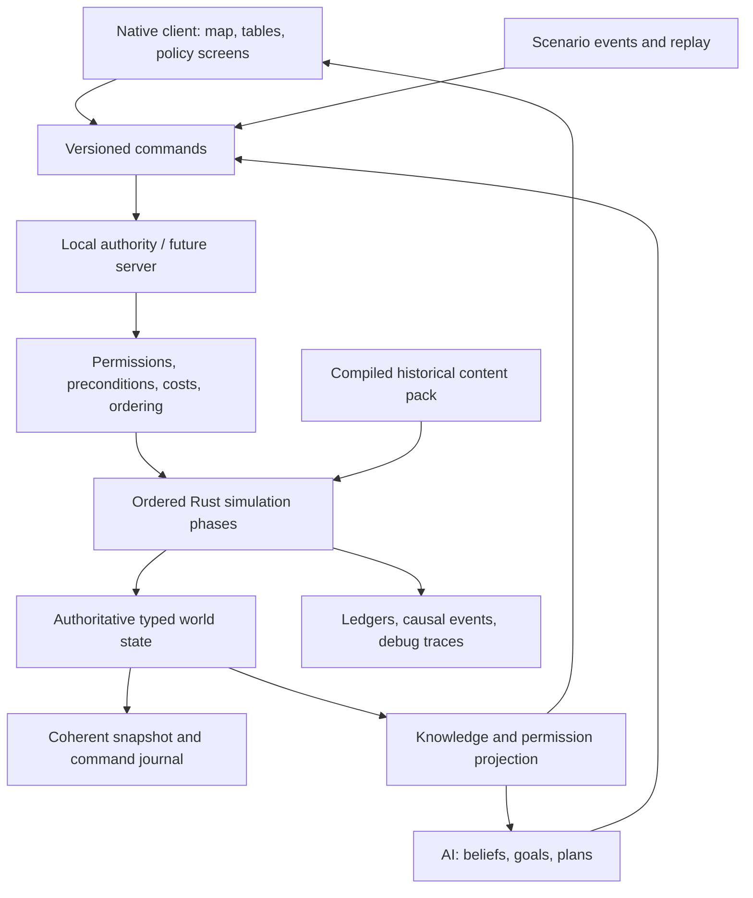

# Technical research and architecture recommendation

Research date: 2 November 2026. Primary-source documentation was checked live. Recommendations and performance targets below are engineering judgments, not measured results or promises by the dependencies. Companion to the [ordered implementation list](implementation-order.md) and [world-data specification](world-data-specification.md); no delivery schedule or workload estimate is intended.

## Recommended decision

Build a standalone deterministic Rust simulation library, a native desktop client using **egui/eframe with the wgpu backend**, and an offline world-data compiler. Render the map through a custom wgpu paint callback using prebuilt vector meshes. Start persistence with **bundled SQLite through rusqlite**, while evaluating **Turso Database, formerly Limbo**, against the same persistence contract. Keep an explicit exit gate for moving the presentation shell to Bevy if the first map/UI prototype proves that game-engine services justify its additional integration surface.

For a solo developer assisted by AI, a map-and-dense-interface game benefits more from strong data tooling, a testable simulation and fast interface iteration than from starting with a general-purpose 3D engine. This choice does not mean building a renderer or GUI toolkit from scratch: eframe supplies the application integration, egui supplies widgets, and wgpu supplies the GPU abstraction. Native desktop, offline play and all three requested operating systems are first-class acceptance requirements.

### Technology decision table

| Area | Recommended starting point | Alternatives and decision rationale |
|---|---|---|
| Authoritative simulation | Independent Rust crate with typed IDs, indexed stores and explicit phases | Bevy ECS may be used internally if measured benefits justify it, but no render resources, OS clock or GUI objects belong in game rules. |
| Desktop shell and dense UI | egui + eframe + wgpu | Direct winit + egui is a later escape hatch if eframe blocks required control. Iced is a credible Elm-style application framework, but switching from an egui prototype must demonstrate a concrete improvement in keyboard behavior, text, styling or layout. |
| Game-engine alternative | Bevy for presentation if the prototype needs its asset, audio, animation and scene ecosystem | Bevy officially supplies 2D/3D rendering, asset hot reload, ECS, audio and desktop platform support. Its default system execution is not deterministic. A Bevy dependency does not solve deterministic simulation automatically. |
| Map graphics | Offline polygon triangulation and LOD meshes, custom wgpu pipeline | Lyon turns paths into triangle meshes. Retain topology and geographic source geometry separately from display geometry. Do not parse and retessellate the world SVG each frame. |
| SVG icons/illustrations | SVG masters; resvg-generated textures or geometry cached by scale | resvg renders static SVG. Use it for imported artwork, not as the entire interactive map runtime. |
| More elaborate vector graphics | Evaluate Vello only on a demonstrated need | Current upstream distinguishes CPU, GPU and experimental compute implementations with different maturity profiles. Broadly saying “Vello is stable” or “Vello is experimental” loses that distinction. Static map geometry does not require a general dynamic vector renderer. |
| Content queries and saves | rusqlite with bundled SQLite | This intentionally includes C SQLite inside a Rust application. Bundling avoids depending on a different system SQLite on every player machine. |
| Pure-Rust SQL candidate | Turso behind a narrow persistence adapter | Current upstream says it is used in production, so old “Limbo alpha, not production ready” claims are obsolete. Its compatibility and workload behavior still need testing for this application. |
| Multiplayer | Authoritative host/server, validated command protocol, filtered state replication | Begin with a local authority implementing the same command boundary. Do not default to peer lockstep because hidden information, late joining and divergent machines create substantial extra constraints. |
| AI | Budgeted, inspectable utility scoring plus hierarchical plans and explicit constraints | No live LLM service in the authoritative tick. Optional generated flavor text should consume established events and never mutate world truth. |

Official foundation sources: [egui repository](https://github.com/emilk/egui), [egui architecture](https://github.com/emilk/egui/blob/main/ARCHITECTURE.md), [Iced](https://github.com/iced-rs/iced), [Bevy features](https://bevy.org/), [wgpu backends](https://wgpu.rs/doc/wgpu/documentation/features/index.html), [Lyon](https://github.com/nical/lyon), [resvg](https://github.com/linebender/resvg), [Vello renderer choices](https://github.com/linebender/vello/blob/main/README.md?plain=1), [rusqlite](https://github.com/rusqlite/rusqlite), [Turso](https://github.com/tursodatabase/turso).

### Implemented administrative reference layer

The desktop [administrative atlas](../crates/desktop/src/administrative.rs) shares an immutable `Arc` cache of 726 Natural Earth v3.3.0 reference areas across the fifteen starter countries. The [offline compiler](../scripts/import_administrative_geometry.py) verifies four pinned original-file checksums, explicit UTF-8 encoding and WGS84 coordinates, preserving source `ADM1_CODE` identities, separate polygon parts and holes. DBF row numbers remain provenance only. Eight records with no source name or type stay explicitly unnamed; the [manifest](../data/administrative-references-manifest.json) records coverage, transformations and historical limitations.

Search accepts attributed names, aliases, country names and source IDs; unique confirmation focuses the selected country's division. Boundary drawing culls polygon bounds against the viewport and displays the inspected country's areas. Hit tests account for holes and both dateline parts; dateline-spanning focus uses the largest contiguous part. Country-level dated public overlays and player authority keep their existing boundaries. These display references do not create simulated regions, administrative powers, local statistics or historical sovereignty claims. Scenario jurisdictions remain separate. Priority 4 remains partial.

### Implemented inspection navigation

The native [history](../crates/desktop/src/navigation.rs) retains at most 64 presentation visits, using typed country/policy identities and a lightweight [map view](../crates/desktop/src/map.rs). It stores no `World`, private projection, geometry cache or accepted command. Screen/country/policy/reference-mode changes create visits; camera/layer changes and draft edits update the current visit. Back/Forward restores presentation state only. Loading, recovery and new campaigns discard history; invalid replacements retain it. Text editors, open popups and campaign/recovery dialogs retain keyboard ownership. Existing per-screen/country scroll IDs continue to retain scroll context independently. Individual panel queries and programme focus are not versioned by this history.

### Bookmark reference index

The native [reference index](../crates/desktop/src/help.rs) reads immutable `Content`, with no `World` argument. Party records retain opening labels/seats; active office terms and explicitly listed collective members determine person-reference roles at `content.start`, not the campaign date. Stable country/party/person/office/term identities remain searchable; destinations derive from typed country/office relationships rather than display names or row positions. Vacancy, absent incumbency, unknown collective membership, validity endpoints and source qualities remain distinct. Latin-accent/macron folding changes only lookup keys. The editor retains ownership through Enter and click-to-clear; related-screen navigation changes presentation context only. Live projections continue through the existing government/observer boundary.

## Architecture boundaries

Suggested workspace modules:

- `sim-types`: IDs, units, dates, numeric conventions, public commands and results.
- `sim-core`: authoritative world state and ordered stepping; runs without a display, database or network.
- `sim-economy`, `sim-politics`, `sim-diplomacy`, `sim-conflict`, `sim-society`: domain behavior, joined through explicit phase inputs and outputs rather than arbitrary cross-module mutation.
- `sim-ai`: observations, preferences, planning, command production and decision explanations.
- `content-schema`: versioned definitions for policies, institutions, events, technologies, parties and scenarios.
- `content-build`: offline import, normalization, validation, source attribution and reproducible content-pack compilation.
- `persistence`: snapshots, command journals, migrations, content hashes and save integrity.
- `protocol`: transport-independent command envelope and replicated views.
- `client`: navigation, widgets, charts, audio and OS interaction.
- `map-render`: map layers, picking, labels, cameras and display-only interpolation.
- `headless`: scenario runner, AI tournaments, replay verification and benchmark executable.

The UI reads immutable, purpose-built views. A click creates a command; a command is validated by the authority; accepted commands become ordered simulation input. Never let a policy slider directly edit a shared `World`. Preview calculations run against an explicit snapshot or a pure forecast model and expose their assumptions.

Keep normal build/test iteration small: domain crates should compile and test without the GPU stack. Avoid splitting every small concept into a crate; the list describes boundaries, and related domains can initially share a crate. Do not build microservices for a desktop game.

### Command identity in the implemented authority

`CommandId` is a distinct campaign-global reference in envelopes, the allocator, receipts, programme proposal history, fiscal programme dispatch and cash-release records. It remains a transparent JSON number in every supported rules/save version; request and project IDs retain their own types. Store boundaries explicitly derive a request's numeric key from its issuing command. Sequence advancement stays checked, and existing authority rejects zero, stale, duplicate or out-of-order incoming IDs. A zero query boundary means before any commands; it is not an issued identity. A typed `journal_entry` lookup resolves host journal records, rejects absent/zero references and verifies stored identity; walkthrough and fiscal dispatch callers use that store method. Public display and diagnostic formatting retain the original numbers. [Identity contracts](../crates/sim-core/src/ids.rs) reject cross-family assignments at compile time; [campaign checks](../crates/sim-core/tests/command_identities.rs) protect pre-change hashes and links through cash release and reviewed budget dispatch.

### Elapsed time at stepping boundaries

The implemented `World::advance` boundary takes `DaySpan`, and `advance_to_event` returns that elapsed unit rather than an absolute day index. Native worker requests, manual/date/automatic controls and walkthrough navigation carry the same type. Terminal day counts and target-date differences convert explicitly at input boundaries; replay uses explicit one-day spans. Simulation dates, limits, daily phase order, partial-step rollback and serialized clock fields retain their existing representation and behavior. This is a Rust API change, not a campaign conversion. [Compile-time contracts](../crates/sim-core/src/rules.rs), [elapsed event regression](../crates/sim-core/tests/elapsed_time.rs) and the native worker's nonzero-bookmark test distinguish duration from destination. Configured durations are extended below; other stored time/rate fields remain primitive, and P01-03 remains partial.

### Authoritative campaign clock

`World.day` now carries [`CampaignDay`](../crates/sim-core/src/campaign_clock.rs), an absolute position on the existing calendar. `checked_add(DaySpan)` composes a checked future position; `elapsed_since` returns a checked elapsed span. Daily ticks and next-event stepping use those operations. Legacy due-date records, calendar queries, formula inputs and client displays explicitly extract the preceding numeric index; this does not yet type every stored timestamp.

Transparent numeric JSON and the original numeric diagnostics preserve content identities, canonical hashes and every existing snapshot format. The module's unit check covers numeric encoding, invalid input, overflow and elapsed composition at a nonzero epoch. Compile-fail contracts prohibit assigning elapsed time or an untyped count to the authoritative clock. Existing calendar, transaction, stepping and replay checks retain the preceding phase order and bounds. P01-03 remains partial for remaining timestamp, percentage, currency and physical-unit coverage.

### Configured durations and policy schedules

Configured construction, consent, leadership review, loan maturity, cooldown, election, fiscal, territorial, subnational, undertaking and cash-protection periods now use `DaySpan`. Income annualisation and reserve-contract duration use the same elapsed unit. Policy and financing previews carry typed delays, as do cabinet preparation results; the recovery runner passes those directly to `advance`. Absolute proposal, decision, due and expiry dates remain calendar indices and explicitly extract elapsed units only when calculating a destination. Stock coverage in days and calendar-year mandate counts remain separate quantities.

Policy construction and amendments compose checked spans before adding them to a date. Cabinet preparation scales a duration with a wide intermediate and one downward rounding; zero denominators and unrepresentable results are refused. Transparent numeric JSON, original numeric diagnostics, all pack hashes and campaign formats remain unchanged. The normal content validation still enforces each procedure's specific range. [Configured-duration checks](../crates/sim-core/tests/configured_durations.rs) protect captured content/pending/delivery hashes, reservation dates, resume/replay, scaling boundaries and invalid input. Compile-fail contracts on government consent, loan maturity and policy previews prevent rate/date substitution. This advances P01-03 without completing remaining rate, calendar, currency and physical-unit coverage.

### Requested elapsed periods in commands

Temporary cash-retention and regional service-grant requests carry `DaySpan` in `Action::HoldCash` and `RegionalOrderKind::Grant`, including stored command journals and regional orders. Cash previews and authority retain that type. Native controls, terminal parsing and AI construct the elapsed span at their input boundaries; the shared command rules enforce the same original duration limits. Cash expiry extracts the elapsed count when checking a calendar destination. Grant scheduling retains the inclusive final payment day, with one explicitly extracted day subtracted from the funded period.

Numeric JSON, debug output, paid administration, escrow, daily payments and all published campaign formats remain unchanged. [Requested-duration checks](../crates/sim-core/tests/action_durations.rs) protect atomic refusal of invalid spans, protected cash, grant payments and captured day-0/day-14/day-44 hashes through exact resume/replay. Compile-fail contracts distinguish a date or basis-point rate from the requested period. Stock coverage retains its separate physical-quantity meaning; broader percentage, calendar and physical/currency coverage remains unfinished under P01-03.

### Physical stock coverage

`NeedDays` represents multiples of a commodity's baseline daily physical requirement. It now types working-inventory ceilings, national reserve capacity and AI targets, retained order quantities and `Action::ProcureReserve` requests, including reserve preview/authority boundaries. Native controls and terminal inputs construct that quantity explicitly. Consent and contract periods carry `DaySpan`; a quoted stock quantity preserves its existing delivery schedule and finite import/cash constraints.

Explicit count extraction at physical multiplication and range-check boundaries preserves all preceding bounds and integer rounding. Transparent numeric JSON, numeric diagnostics and every existing content/snapshot format remain unchanged. [Stock-coverage checks](../crates/sim-core/tests/stock_coverage.rs) protect invalid input, atomic quantity refusal, actual fees/reservations/stock and captured pending/partial/completed hashes through exact resume/replay. Compile-fail contracts distinguish inventory coverage from elapsed time and basis-point rates. Percentage settings, calendar indices and broader physical/currency coverage remain unfinished under P01-03.

### Basis-point fields and ratios

Basis-point configuration and live records now retain `BasisPoints` rather than bare signed/unsigned counts. This includes authored GDP costs, fees, financing rates, tax-band thresholds/multipliers, market indices and limits, regional shares/entitlements and reserve prices. Reported preference distances/coverage and group-mean Gini use the same normalized ratio unit; unknown values stay absent. Public marginal-tax and next-market-price calculations carry that unit across their boundaries. Percent counts and calendar days cannot silently become basis-point fields.

The existing positive scalar JSON and per-procedure ranges remain unchanged. Negative or unrepresentable external values fail before they can enter a rate field. Numeric formatting and explicit unsigned/signed extraction preserve the existing bounded arithmetic and every legacy rounding point; this does not combine previously separate fee calculations or recalibrate policy costs. [Configured-rate checks](../crates/sim-core/tests/configured_rates.rs) protect numeric encoding, invalid input, actual paid appointment/amendment/loan controls, pending dates and the pre-change day-14/day-200 hashes through resume/replay. Compile-fail contracts distinguish cash, percent counts and calendar days from rates. Percentage-valued settings, calendar indices and broader physical/currency coverage remain unfinished under P01-03.

### Opening percentages and annual GDP

`CountryDefinition` carries `Percent` for opening tax, service/welfare spending, food/energy capacity, administration and approval. Field-specific limits retain production above 100% where previously permitted. `AnnualGdp` carries the nonnegative annual monetary calibration through country definitions and regional/reserve cost helpers; it is distinct from spendable `Money`. Explicit extraction preserves existing arithmetic, rounding, signed live fields and displays. Numeric JSON and diagnostics retain all content identities and snapshot representations. [Opening-percentage checks](../crates/sim-core/tests/opening_percentages.rs), [annual-GDP checks](../crates/sim-core/tests/annual_gdp.rs) and compile-fail contracts protect these boundaries. Remaining percentages, timestamps, currency and physical dimensions keep P01-03 partial.

### Typed population across content and live state

`CountryDefinition::population` uses the same transparent `Population` type as live country/cohort counts and public reports. Initialization transfers that typed value directly; world and reserve checks compare population units. Fact validation, cohort partition inputs, income-tax ratios and client number formatting explicitly extract the scalar count at their numerical boundaries. Existing unsigned JSON numbers, source bounds, integer partitions, wide intermediate arithmetic and rounding remain unchanged. [Compile-time contracts](../crates/sim-core/src/model.rs) reject money and implicit raw-count substitution; [regressions](../crates/sim-core/tests/population_units.rs) preserve all twenty-three content/opening hashes and an uneven-census day-61 progression. Broader unit coverage remains P01-03.

## Simulation cadence and determinism

Use an integer simulation clock. A proposed baseline is an hourly command/event boundary, daily operational and market settlement, weekly strategic AI reviews, and monthly demographic, fiscal reporting and structural updates. These are design starting points; calibration must determine whether batching creates implausible jumps. A long construction project should track continuous progress rather than suddenly existing on a month boundary.

Display interpolation and camera animation use render time. Game speed controls how many simulation steps run; it must not alter formulas or cause “missed” ticks. AI decision budgets should count candidate evaluations or planning expansions, not elapsed milliseconds, if the same replay is expected to reproduce its choices.

Determinism requirements:

1. Fixed phase order and explicit dependency graph.
2. Stable IDs independent of memory location, ECS allocation and language hash-map randomization.
3. Stable sorting before any order-sensitive conflict resolution or reduction.
4. Integer or fixed-point representations for money, population counts, quantities and policy parameters where feasible; declared scales, rounding and overflow behavior. Use wider intermediate arithmetic and test boundary ranges.
5. Explicitly controlled floating-point calculations where unavoidable. Do not assume “Rust” guarantees cross-platform identical math. Keep GPU math out of authoritative rules.
6. A versioned named PRNG and independent deterministic streams by subsystem or actor. Persist seeds and counters. Avoid changing all political events because a visual particle consumed a random number.
7. Parallel workers produce isolated proposals or deltas, which the authority commits in stable order. Thread completion order cannot determine world events.
8. Replay input includes simulation version, content hash, mod order, settings, seed and ordered commands. Changing rules can intentionally invalidate old replays; be explicit about that support policy.
9. Canonical per-subsystem hashes and an inspectable first-divergence dump in the headless runner.

Bevy's [FixedUpdate](https://docs.rs/bevy/latest/bevy/app/struct.FixedUpdate.html) separates fixed logic from rendering, while its [system documentation](https://docs.rs/bevy/latest/bevy/ecs/system/index.html) explicitly describes default execution as parallel and nondeterministic. FixedUpdate alone is therefore insufficient. [rand_chacha](https://docs.rs/rand_chacha/latest/rand_chacha/) documents deterministic portable generators; pin the generator and its surrounding sampling algorithms rather than assuming every dependency update preserves all samples.

### Implemented daily dependency order

The current authority runs one complete country pass in ascending `CountryId` order, then a monthly AI pass over that same order. This is an explicit sequential dependency chain, not a parallel system scheduler:

1. Increment the absolute daily clock. For fiscal-plan content, close the previous fiscal year before January decisions or payments.
2. Notice technology/statutory proposal dates; resolve cash holds, constitutional decisions and statutory consent/implementation; reconcile undertakings and territorial succession/reviews.
3. Synchronize electoral mandates, resolve election requests, regional orders, cabinet appointments and budget bills, then policy consent and borrowing.
4. Complete due projects, review reserves, settle production/households/fiscal flows, then evaluate commitments and undertakings. Legacy content without fiscal plans closes its budget after settlement.
5. Resolve due political/electoral/leadership reviews and reconcile the resulting mandates, succession, statutory bill sponsorship and cash holds.
6. After every country has settled, run monthly foreign-government AI in stable country order. Retain the ledger window and perform the one-time campaign review afterward.

The only implemented stochastic subsystem is supply disruption. Its `supply-v2` stream uses FNV-1a-64 on the exact UTF-8 key with decimal seed/period fields `{seed}:{country_id}:{period}:supply-v2`; `period = (absolute_day - 1) / 90` for settlement days starting at one. A sample divisible by three causes a `10 + sample % 16` capacity reduction on the first twenty days of that period. Seed and absolute day are saved, so the period index is reconstructed without a mutable cursor. Adding another country or rendering a frame consumes no supply samples. This hash-derived sampler is not a general-purpose statistical PRNG; future stochastic domains must define separately versioned stream keys and sampling rules. Changes to either mapping or distribution require an explicit rules-version compatibility decision. [Pinned vectors and roster/resume tests](../crates/sim-core/tests/random_streams.rs) protect the current contract; [sampling implementation](../crates/sim-core/src/random.rs) contains additional fixed vectors.

### Versioned political selection

Rules 24 order nonincumbent parties by stable `PartyId` before distributing the 100-seat model's integer remainders. The successor coalition's largest party leads; equal seat totals prefer the lowest ID, and new successor coalitions list their members in the same canonical order. Display names and input row order do not settle these choices. Remainder division uses the actual collection count without narrowing it to a seat-sized integer. Earlier rules preserve their published row order and last-encountered equal-seat leader; changing those old algorithms would invalidate existing replays.

The new historical starter preserves every preceding country/party definition and resource parameter. The fictional fixture adds one explicitly authored party with unknown fiscal preferences. Snapshot 25 distinguishes the new political semantics even though the world field layout remains compatible; rules 24 reject older envelope numbers. [Ordering tests](../crates/sim-core/tests/stable_elections.rs) reproduce permutations and ties and preserve exact old counterexamples. [Starter/recovery tests](../crates/sim-core/tests/stable_elections_starter.rs) verify old pack identities and backups alongside its preserved starter. The model remains an authored approximation rather than an implementation of national electoral law.

## Persistence: SQL is storage, not the inner game loop

Load normalized scenario data into typed in-memory state. Avoid querying SQL separately for every country, market, household or military unit on every tick. Tables are useful for the content compiler, scenario editor, debugging queries, historical series and durable save metadata. Dense arrays and indexed stores are generally a better starting point for hot simulation loops.

Suggested save package: manifest, versioned world snapshot, recent command journal, compressed historical series, content/mod manifest and integrity hashes. A single SQLite container is possible, but is not mandatory. Do not confuse a database's physical file compatibility with a durable application save schema.

Save on a coherent tick boundary. Copy or version the snapshot, write on a background worker, then commit/rename atomically as appropriate for the selected format. Retain a rotating previous autosave. Test interrupted writes, damaged files, missing mods and schema migrations. Never rely on copying a live database file while ignoring its journal or WAL. Use the database's supported backup/checkpoint approach if saves are database copies.

Turso evaluation gates: required SQL features and constraints; file interoperability if promised; transactions and crash recovery; durability under interrupted writes; prepared statements; platform packaging; content import throughput; long campaign history growth; migration tool support; and real save/load latency. Upstream now states that Turso is a production database and that libSQL has been battle-tested longer. Treat the choice as workload validation, not a referendum on whether a Rust rewrite is legitimate. [Turso official FAQ](https://github.com/tursodatabase/turso). rusqlite's bundled feature compiles a fixed SQLite library as part of the application. [rusqlite build documentation](https://github.com/rusqlite/rusqlite).

## Multiplayer preparation without building multiplayer first

Single-player starts an in-process authority. The future server runs the same simulation with no renderer. Humans, AI, replay playback and scenario scripts all issue commands through the same validation boundary. Commands carry a unique ID, actor/role identity, intended tick, payload version and preconditions. The authority assigns order, rejects invalid actions and handles duplicate delivery idempotently.

Replicate only the information that each player is entitled to know. Separate the actual world, actor beliefs and the player's public view from the beginning. Sending a full world snapshot to every client and hiding secret intelligence in the UI is insufficient for competitive multiplayer.

Prepare protocol versioning, content/mod checksums, save-and-resume, reconnect snapshots plus subsequent deltas, spectator views, speed/pause ownership, AI takeover and country co-op roles. Transport selection, account services, matchmaking, NAT traversal, relay services, Steam integration and anti-cheat remain a later project. A deterministic core remains valuable for debugging even if clients never simulate the whole authoritative world.

Before promising multiplayer readiness, test two local clients with independent render rates and injected command delay. Verify identical validated results, no duplicate purchases, no future-state leaks, recovery from disconnect and rejection of a modified content manifest. Implement the seam now; defer the product surface.

### Implemented command and knowledge boundaries

`World::execute` accepts the current command envelope (`id`, `day`, `issuer`, `action`); `World::issue` constructs it for the controlled government. Desktop actions and terminal scripts use this authority. AI, reviewed budget dispatch and replay reach the same internal dispatcher through trusted origins that are not fields of incoming commands. Stale/duplicate IDs or days, foreign issuers, wrong content and failed action conditions are rejected before acceptance. The current reference-enabled rules roll back failed commands, including event-allocation failures. Developer commands require a separate trusted host path, validate their bounds and permanently mark the campaign.

`execute_with_receipt` and `issue_with_receipt` return an ephemeral `CommandReceipt` containing the accepted command number and its retained immediate `EventId` outcomes. Reference-enabled commands must record an outcome before entering the accepted-command journal. Native status and terminal replies identify those outcomes for Chronicle lookup. Acceptance of a proposal does not certify later consent, funding or delivery; older campaigns retain their original event text without invented references. Receipts are derived responses, not additional saved state or access grants.

`World::project` supplies a government with its own private country/events plus public reports for the roster. Observers receive only public reports. Statistical releases retain their actual dates; opening absence remains unknown, and live foreign balances, cohorts, pending requests, execution, event streams and AI plans are excluded. Legal public appointments/decisions and approved fiscal-setting history are exposed by their dedicated published types. Map overlays and ordinary public charts/comparisons consume those reports; treasury history is restricted to the controlled government. Current AI heuristics read their own government's state. Richer beliefs, census error and intelligence remain later systems. The trusted host assigns `Viewer`; projection minimizes data and does not authenticate a network session. Networking, account roles and replicated transports remain Priority 41.

### Implemented replay and AI evidence

[`replay_trace`](../crates/sim-core/src/replay_trace.rs) observes the shared replay driver at opening, completed daily ticks and accepted manual/developer commands. Version-1 JSONL sidecars contain canonical world and country/domain component hashes, with explicitly sorted object keys and unchanged array order. They are streamed separately from campaign saves. Input identity includes content/rules, seed, player, scenario, time range and manual-input identity; snapshot agreement and failed execution outcomes remain separate. The bounded reader checks chronology, sequence, component ordering and completion. Comparison checks the whole evidence stream and reports its first differing boundary/components, including transient differences whose final hashes agree. A reference must have been captured before the compared engine change; a final snapshot alone cannot establish the earliest divergence. Ordinary replay retains command and final-state validation.

[`ai_inspection`](../crates/sim-core/src/ai_inspection.rs) borrows accepted automated journal entries and retained AI review messages for one country. It reports totals, newest-first bounded collections and reviewed-budget dispatch origin without inventing scores, missing explanations or command/event associations. The player-controlled country is labelled. Both interfaces are restricted to the explicit developer host and leave world hashes and certification unchanged. Normal government projections retain their privacy boundary. These refine the existing command audit, private transfer ledger and country/AI events; future systems require their own evidence.

### Optional authored statutory authority

[`legislation`](../crates/sim-core/src/legislation.rs) defines stable law/bill IDs, attributed date/country availability and target-dependent policy prerequisites in optional rules/content 26. A proposal uses the current governing route, pays drafting administration from actual uncommitted cash and protects the remaining implementation cost. Current backing is rechecked at consent; implementation pays the protected cost before recording enacted permission. Withdrawal, refusal or sponsoring-government succession releases only unspent funds. Paid work and cooldowns persist, while enacted statutes survive government succession. Adoption itself changes no production, services or treasury credit.

Policy commissioning, commitment amendment and changed fiscal targets enforce the same prerequisite. Stored programme commands and budget proposals validate permission at their original dates. Campaign-day dates, elapsed periods, annual-GDP calibration and basis-point costs retain their distinct types. January closes preceding fiscal accounts before statutory payments, and pending law work reconciles with all other protected cash. Configured AI targets use ordinary paid commands. Pending and enacted records validate through snapshot format 27; earlier rules omit statutory state and retain their bytes. The new normal owner panel sits after the foreign-public-report guard; read-only developer inspection retains its existing explicit-host boundary. [Legislation checks](../crates/sim-core/tests/legislation.rs) cover finances, lifecycle, bypass prevention, dates, malformed state, rollback and exact resume/replay. This is a limited authored statutory workflow, with broader P02/P08/P12/P13 coverage unfinished.

## Logical AI implementation criteria

Separate interests, beliefs, constraints and action selection. A country does not have one utility function forever: government survival, ideology, fiscal health, external security and coalition commitments can conflict. Individual ministers, parties, firms, unions and military institutions can influence or block plans through modeled capabilities rather than random vetoes.

Use hierarchical planning: strategic goals choose bounded plans; plans generate feasible actions; utility scores rank alternatives; commitment and cooldown rules prevent oscillation. Evaluate plans over a short approximate horizon with uncertainty penalties. Share action validators with players so AI cannot spend nonexistent money or ignore legislative procedure.

The practical first version should be strong heuristics with explanation traces, not machine learning. Record “rejected because insufficient coalition votes,” “preferred because energy shortfall was projected,” and the few highest-scoring alternatives. Plan budgets can vary by strategic relevance, but all countries must still satisfy basic survival and maintenance rules.

Tests: prolonged peace and war runs; resource shortages; debt spirals; opposing ideology coalitions; treaty compliance; opportunistic exploitation; geographically isolated countries; tiny economies; lost capitals; regime transitions; and save/reload during a plan. Measure bankruptcy frequency, policy oscillation, unmet essential demand, stalled plans, impossible orders and AI reasoning time. Historical plausibility is a calibration target, not a requirement to reproduce known outcomes after the player changes history.

## Map and asset pipeline

Keep sovereign identity, legal claims, effective territorial control and map geometry as different concepts. Stable atomic geographic regions allow country formation, secession, occupation and annexation without generating a new global coastline mesh every time. Administrative regions, electoral districts, supply zones and market areas can group those atoms differently. Distinguish country boundaries from province and military movement granularity.

Offline flow: source archive and license → geographic normalization → validity repair → topology/shared-edge construction → antimeridian handling → deterministic simplification → triangulation → LOD packages → adjacency and transport graph → packaged content. Validate islands, enclaves, multipolygons, holes, tiny states and wraparound. Preserve full-resolution sources so display simplification is reproducible.

At runtime: immutable GPU mesh buffers; per-region ownership and overlay values in compact buffers; batched borders; spatial index or ID-buffer picking; zoom-dependent labels; viewport culling; precomputed adjacency; and separate route/flow overlays. Avoid rebaking geometry merely to recolor a map. Borders represent legal/control/claim distinctions using line treatment, not only hue. Colorblind-safe palettes, patterned contested areas and searchable map layers are essential.

Use SVG for original icons, flags and simplified portraits; consistent authored illustration is preferable to thousands of mismatched photographs. Commission or create an original icon language where generic icons fail. Lucide provides a permissively licensed base, with ISC and inherited MIT notices that must accompany distribution. [Lucide license](https://lucide.dev/license). Build a per-asset ledger recording original URL, creator, license, modifications and required credit. A Commons image is not automatically public domain; inspect each file. Flag geometry and photographs also have different licensing and jurisdictional issues.

## Data sourcing and circa-2000 limitations

No single source supplies every country, every party, every leader and every statistic with complete historical coverage and convenient commercial redistribution rights. Treat the world database as a product with coverage metrics and editorial review, not a one-time API download.

| Source | Use | Verified restriction or limitation |
|---|---|---|
| [Natural Earth](https://www.naturalearthdata.com/about/terms-of-use/) | Global coastlines, land and base cartography | Public domain, including commercial modification. Current map data is not automatically a valid 2000 political map. |
| [geoBoundaries gbOpen](https://www.geoboundaries.org/api.html) | Administrative boundaries and source metadata | CC BY 4.0; select gbOpen. gbAuthoritative is not for commercial use; gbHumanitarian can have different terms. Year-of-validity varies by file. |
| [geoBoundaries global/individual descriptions](https://www.geoboundaries.org/) | Boundary representation policy | Individual countries represent themselves; global composites include disputed areas. Select deliberately and document dispute treatment. |
| [Wikidata licensing](https://www.wikidata.org/wiki/Wikidata:Licensing) | Stable IDs, names, office-holder intervals, parties, organization membership and crosswalks | Structured data is CC0. Completeness and dates require validation; photographs and linked source prose do not inherit CC0 automatically. |
| [World Bank licensing](https://datacatalog.worldbank.org/public-licenses) | Country-year economic, population, development and service indicators | Default for Bank-produced open data is CC BY 4.0 with additional terms. Some third-party data and microdata have different restrictions; inspect the exact series and release. |
| [ParlGov](https://www.parlgov.org/data-info/) | Parties, elections and cabinets in established democracies | Useful partial coverage, not a global party registry. Inspect the exact release license before bundling; the page inspected does not establish blanket redistribution permission. |
| [V-Dem FAQ](https://www.v-dem.net/about/faq/) | Regime and institutional indicators, calibration | CC BY-SA 4.0 per current project FAQ. Attribution and derivative-data sharing requirements need an explicit packaging decision. |
| [Correlates of War](https://correlatesofwar.org/data-sets/) | Potential background reference for conflict and international system concepts | Published terms prohibit commercial activity and third-party redistribution without written permission. Do not incorporate into a commercial game data pack by default. |
| [OpenStreetMap licensing](https://wiki.openstreetmap.org/wiki/Open_Database_Licence) | Optional transport and infrastructure research | ODbL share-alike dataset terms. The linked wiki is descriptive; consult OSM Foundation license policy for packaging decisions. Modern OSM does not establish the world infrastructure of 2000. |

Other candidate families to investigate at implementation time: national statistical offices, election commissions, central banks, UN population and agency databases, FAO, ILO, UNESCO, WHO, IMF, official treaty repositories and international organization archives. They are candidate sources, not verified blanket licenses or claims of complete historical coverage in this research.

Store `valid_from`, `valid_to`, observation year, publication/revision date and source separately. A 2000 scenario may use subsequently revised historical statistics, but should label this rather than imply that policymakers knew the revised figures in 2000. Never fill missing data with zero. Every value should have provenance, units, quality class and an imputation method where applicable.

Recommended quality classes: directly observed, reconciled from multiple sources, interpolated, inferred from regional peers, authored gameplay approximation, unknown. Store uncertainty where it changes decisions. Leaders need office terms and succession rules, not just one “leader” string; parties need founding/dissolution/merger dates; organizations need membership intervals and accession rules. Historical leaders can be sourced facts while fictional successor personalities and game-generated decisions remain clearly simulation content.

The 2000 start requires a curated temporal layer: predecessor states, disputed territories, membership and currency arrangements, infrastructures not yet built, and institutions that did not yet exist. Do not retroactively start every modern country as independent. Future independence or institutional change should emerge through rules or scenario events and may fail to occur in an alternative history.

## Interface prototype and acceptance gates

Prototype one coherent decision loop: select country → inspect economy → identify a problem → compare policy alternatives → see legal and fiscal constraints → enact → advance time → explain the observed result. The interface must answer “what changed, why, who is affected, when will it work, and what can I do?”

Use a persistent map and country context, a compact situation summary, an organized event inbox, a searchable policy catalog, sortable virtualized tables, linked charts and a pinned comparison tray. Keep units, dates, uncertainty and baseline comparisons visible. Avoid burying important state behind many modal windows. Alerts should be actionable and deduplicated, with configurable auto-pause severity.

Evaluate egui with a styled production-like screen, not its default demo theme. Verify keyboard-only navigation, text selection/copy, tooltips accessible without precise hovering, IME, Unicode names, high-DPI scaling, 1280×800 layout, 4K scaling and color vision. Test a 10,000-row virtualized table, several charts and a moving map together. If these cannot meet usability expectations without extensive custom-widget work, benchmark Iced or Bevy UI on the same task before commitment.

Proposed performance targets to validate on a named baseline laptop, not promises: smooth map interaction around 60 FPS; input acknowledgement under 100 ms; autosave causing no noticeable long main-thread stall; a multiyear headless benchmark comfortably faster than interactive maximum speed; and bounded history/save growth over a 50-year campaign. Record median and tail tick times, memory, save size, load latency and UI frame time. Select final numeric simulation-speed targets only after the world population and economic granularity are fixed.

Release gates: reproducible replay on Windows/Linux/macOS and ARM64/x86-64 targets being supported; long-campaign soak; conservation/accounting invariants; migration coverage; corrupt-save handling; mod schema validation; asset/license manifest; offline installation and launch; and real platform packaging checks. Mac signing/notarization, Windows signing/reputation and Linux compatibility are release workstreams, not side effects of writing Rust.

## Concrete authority and information flow



This is an architectural boundary, not a requirement to make each box a separate process. The first client can call the local authority directly. Database, renderer and network handles must not enter domain-rule functions.

Suggested conceptual interfaces:

```rust
// Illustrative contracts, not a dependency/version-specific implementation.
fn validate(world: &World, actor: ActorId, command: &Command)
    -> Result<ValidatedCommand, Rejection>;

fn step(world: &mut World, inputs: &[ValidatedCommand], content: &Content)
    -> TickReport;

fn project(world: &World, viewer: ViewerId) -> PlayerView;

fn choose_actions(observation: &Observation, memory: &AiMemory)
    -> Vec<Command>;
```

A command envelope includes command ID, issuer, controlled role, requested execution boundary, schema version and relevant preconditions. A stale preview cannot guarantee execution: the authority revalidates current cash, powers, capacity, counterpart acceptance and outstanding commitments. Multi-party actions commit atomically or fail with an explanation.

Separate static definitions from dynamic state. A `PolicyDefinition` is shared content; a `PolicyInstance` holds jurisdiction, parameters, implementation progress and obligations. The same distinction applies to technologies, facility types, institutions and scenarios. Do not duplicate an entire definition for each country.

## Practical simulation model

The following are proposed modeling choices, not claims that any comparator uses these algorithms.

**Geographic detail:** use administrative regions for most population and service statistics, with a separate finer geographic/route graph for logistics and military control. A change in an army's position should not force population cohorts to move to a different statistical region. Country formation changes jurisdiction mappings; it does not rewrite physical geography.

**Economic detail:** begin with sector-region production units, cohort households, government accounts and external trade. Add individually modeled strategic firms, banks and facilities when their distinct ownership or behavior creates a decision. Do not require a universal firm-by-firm or person-by-person simulation.

**Production:** feasible output is bounded by installed capacity, available labor/skills, energy, intermediate inputs and access. Each production recipe defines units. Substitution requires an explicit recipe or elasticity rather than a blanket productivity bonus.

**Markets:** calculate desired demand, affordable demand and feasible supply separately. Use inventories, trade and transparent allocation/rationing rules to settle unmet demand. Prices adjust with bounded rates and defined lags. If a numerical solver is used, iteration limits and tie-breaking must be deterministic; expose non-convergence rather than silently producing invalid values.

**National accounts:** derive value added from output less intermediate consumption. Do not count every intermediate sale as GDP. Reconcile expenditure and production measures with documented balancing rules. Services, depreciation and inventory changes need consistent definitions. This is a game abstraction requiring calibration, not a full claim of statistical-system equivalence.

**Finance:** money changes hands through explicit transactions; monetary creation, credit/deposit creation, repayment, write-offs and defaults have declared balance-sheet effects. Total money is not universally conserved. Financial claims and liabilities must reconcile across counterparties within the chosen accounting scope.

**Policy effects:** use mechanisms and constraints. A subsidy changes a recipient's costs/cash, which can alter prices, output, hiring and investment. It should not independently add an arbitrary amount to GDP while also increasing production, which would double-count its effect.

**Politics:** cohorts evaluate outcomes through preferences, salience, perceptions and trust. Parties compete for support under actual electoral rules. Approval, vote intention, turnout, legitimacy and organized opposition are different states. Election outcomes are not simply a copy of approval.

**Time steps:** one possible ordered settlement is:

1. Apply valid queued commands and due legal/event transitions.
2. Update availability: damage, maintenance, weather and operational movement.
3. Calculate planned production, household/service demand and logistics needs from a consistent input snapshot.
4. Allocate feasible inputs, production, trade and consumption using explicit priority rules.
5. Settle physical inventories and financial transactions; record shortages and obligations.
6. Update employment, service access, welfare and political perceptions at their configured cadence.
7. Review due AI plans; queue actions for the next permitted boundary.
8. Publish permitted views, causal explanations, histories and checkpoint hashes.

The exact order is part of the rules version. A military strike occurring before or after economic settlement must be intentional. Fast-forward executes the same steps and never skips essential state transitions.

Use integer/fixed-point values for authoritative accounting, retaining residual fractions where repeated rounding would leak units. Bound the supported scales, use wider intermediates and test very small and very large economies. Parallelize independent calculations against stable snapshots, then merge results in a fixed order.

## AI: from constraints to a useful decision

Country AI should answer four questions independently: **what do I want, what do I believe, what can I legally and materially do, and which feasible plan is best?**

An implementable pipeline:

1. Update beliefs from observations and reports; retain uncertainty and report age.
2. Detect problems and opportunities: essential shortages, financing gaps, election risk, threats, infrastructure bottlenecks or treaty opportunities.
3. Select a bounded set of goals using doctrine, office mandate, ideology, coalition promises and current crisis severity.
4. Generate candidate plans from reusable templates. A power shortage might suggest imports, repair, demand management or new capacity.
5. Reject actions failing the same validators used by humans.
6. Forecast a short horizon using an approximate model with explicit assumptions. Full-world rollouts for every candidate are unnecessary.
7. Rank plans by expected gains, fiscal/resource cost, political consequences, risk, delay and commitment conflicts.
8. Commit, monitor prerequisites, execute through commands and reconsider only when review conditions are met.

Conceptually:

```text
plan_value = expected_goal_progress
           - resource_opportunity_cost
           - political_and_diplomatic_cost
           - uncertainty_penalty
           - breach_and_switching_cost
```

Weights differ by actor and mandate; they are not universal claims about rational government. Hard constraints stay outside the score: an infeasible plan cannot win because its abstract benefits are large. Record candidate IDs, forecast assumptions, scores, rejected conditions and the chosen plan for debugging.

**Example:** a government faces insufficient electricity before winter. AI checks import access, transmission capacity, reserves, cash, available repair crews and construction lead times. A new plant cannot solve an immediate deficit. It might negotiate temporary imports, fund repairs and offer targeted household relief, while beginning a longer-term project. When imports become unavailable, it revises the plan instead of repeating an impossible order each day.

Negotiation AI evaluates concrete bundles against alternatives. Military AI uses objectives and logistics. Firm AI weighs solvency, profitability and investment. Party AI weighs program, voters, offices and coalition credibility. These agents can share planning infrastructure while having different utility terms and legal powers.

Do not make a runtime LLM responsible for authoritative orders, arithmetic or international state. It would add cost, latency, offline dependence and reproducibility problems. Optional narration can describe already validated events and must have a deterministic template fallback. Learning-based policies can be explored later using the headless environment, but first need a strong heuristic baseline and measurable improvement.

## UI layout and decision design

Suggested default arrangement:

```text
┌ Country / role ─ Date ─ Pause & speed ─ Search ─ Situation summary ┐
│ Ministries │                                                    │
│ and views  │              Map / selected workspace               │
│            │                                                    │
│            │                                  Context inspector │
├────────────┴────────────────────────────────────────────────────┤
│ Decision inbox / pending bills / projects / commitments          │
└─────────────────────────────────────────────────────────────────┘
```

Use the center for either the map or a full-width analytical workspace, preserving selection and camera state. Dense tables deserve room; do not force them into a thin sidebar because the map is permanently dominant. Clicking a region or indicator links to the relevant view.

A policy screen should show: current rule, proposed change, legal route, who gains/loses, expected cost, capacity requirements, implementation timeline in game time, uncertainty, alternatives and final confirmation. Use a draft/apply distinction. The forecast must not imply that an uncertain outcome is guaranteed.

An indicator screen should show: definition, unit, period, trend, components, drivers, affected regions/groups, comparison and relevant actions. Fiscal explanations require a ledger view; supply problems require a flow/capacity view; legislative problems require a procedure/coalition view. One generic tooltip cannot explain all three adequately.

Keep serious events interruptive only when a decision is actually needed. Repeated shortages should update an existing issue, not generate a new modal every tick. Permit players to automate routine responses with limits and to inspect what automation did.

## Build dependencies without unnecessary infrastructure

### Regime and ideology implementation

Use composable institutional rules, not a single `Democracy / Dictatorship` branch. Government state references executive selection, legislative procedure, party competition, effective decision rights, succession and survival-coalition definitions. Keep formal permissions separate from contested extra-constitutional actions: the engine can validate a simulated attempt to seize powers without pretending that the attempt is constitutionally lawful or guaranteed to succeed.

Ideology belongs to actor preferences and declared doctrine; regime rules belong to institutions. Country AI chooses objectives according to both. An elected coalition may prioritize swing voters and partner support; a party leadership may prioritize internal factions and cadre implementation; a personalist ruler may prioritize elite loyalty and succession. These are configurable motivations, not deterministic stereotypes. Government survival and public welfare can conflict, and the player can choose ideological commitments or pragmatism.

Reuse policy, command and commitment infrastructure across all regimes. The same spending proposal may require a parliamentary vote, party approval, council assent or decree. Every route still needs cash, staff, enforcement and cooperation. Interface views select the relevant institutions instead of showing meaningless parliamentary screens everywhere.

Add fixtures for a functioning one-party succession, a failed personal succession, a divided junta, a constrained absolute monarch, a dominant-party election, democratic backsliding and negotiated democratization. Verify that changes preserve accounts and obligations, update decision rights and AI goals, and do not automatically equate low popularity with removal. These systems belong in the initial political foundation, not a later authoritarian-content expansion.

### Engineering choices

- Use a Rust workspace, a pinned toolchain and a lockfile. Initially keep related domains as modules; introduce more crates when boundaries improve compilation, testing or ownership.
- Prefer local files and a reproducible content compiler over a live backend. An offline campaign must not depend on a statistics API staying available.
- Keep save/content/protocol schemas explicit. General serialization support alone does not define a stable long-term format.
- Keep graphics interpolation, visual randomness and optional audio entirely outside authoritative state.
- Profile before adding ECS complexity, multithreading, GPU computation or dynamic scripting. Data layout and avoiding redundant calculations come first.
- Confirm UI crate compatibility, rendering integration and target-platform support in a representative prototype before pinning versions. No exact version number is asserted here as a permanent choice.
- Cross-platform delivery includes actual tests on macOS, Linux and Windows; a successful cross-compilation is not evidence that input, fonts, graphics drivers, saves and packaging work on a user's machine.


### Bounded archived review samples

Rules 25 adds the [statistical archive](../crates/sim-core/src/statistical_history.rs). After retaining 120 ordered `Observation` values, each retired review enters a calendar-year bucket. At most one review per country/day yields at most 366 samples/year and at most 101 buckets within the campaign calendar. Checked integer sums retain money units and bounded percentage sums. Public summaries omit treasury and all private sums; each published mean carries its sample count and first/last review dates. Means floor once and do not stand in for annual accounts or continuous daily histories.

The [retention tests](../crates/sim-core/tests/statistical_history.rs) compare twelve simulated years with preserved rules 24, independently reconstruct retired samples and verify that normalizing only the new archive/content identity leaves the rest of the world identical. Date, sum, missing-state and envelope checks reject invalid archives. Snapshot 26 and exact-hash bundled loading preserve earlier files; the combined starter keeps the dated opening-reference crosswalk while every prior pack stays unchanged. [Trends](../crates/desktop/src/analysis.rs) renders archive means as separately labelled series and exposes sample coverage. The archived year being filled can be partial; its plotted date is the last sampled review. The combined pack is now the new-game default in both clients. The chooser retains the preceding rules-24 starter, and default loading resolves every preserved bundled hash before switching world/content together. Existing files are not migrated.

### Typed scheduled dates

The remaining scheduled/tenure dates use the same transparent numeric `CampaignDay` as the authoritative clock and recorded chronology. The 91-field migration covers fiscal period bounds; policy consent/delivery; appointments and tenure bounds; constitutional/electoral decisions and cooldowns; loan issue/maturity/payment dates; reserve lifecycle dates; regional/territorial schedules; undertaking deadlines; and their public/preview projections. Cash-retention ending tuples and budget-preview programme tuples also carry typed dates. The normal UI converts dates explicitly for legacy formatting, chart coordinates and widget keys, preserving the preceding numeric identifiers.

`CampaignDay` gains no numeric comparison or arithmetic operators. Date addition accepts an elapsed `DaySpan`; legacy calendar and valuation helper boundaries retain explicit numeric conversions and their existing rounding/overflow behavior. Numeric snapshot/content encoding and all existing rule versions are preserved, with no synthesized dates or new content pack. [The scheduled-date regression](../crates/sim-core/tests/scheduled_dates.rs) follows genuine budget/loan consent through New Year from a December bookmark, checks maturity and fiscal-period bounds, and resumes/replays a cash hold expiring on January 2. Compile-fail contracts reject raw counts, rates and durations where absolute dates are required. P01-03 remains partial for remaining numeric helper APIs, live rates, currency/distance and broader physical dimensions.

### Optional governing institution context

The rules/content-28 [starter](../data/initial-2000-governing-institutions.json), derived by the [offline builder](../scripts/build_governing_institutions_world.py) from the preserved executive-identity pack, adds 105 explicitly authored modeled institutions: one per country for each of the six existing decision routes, plus a consultative council. `InstitutionId` is independent of person, office, executive-body and government-mandate identity. Complete route bindings resolve by identity rather than labels or catalogue order. Institution names, roles and provenance are validated; historical membership, foundation dates and votes are not synthesized. The six routes retain their existing policy and consent behavior.

Accepted ordinary commands capture their current `GovernmentId`, primary institution, decision route and applicable consultative context in the journal. This is submission context, not an approval or voting record. Developer bypasses carry no governing attribution. Snapshot format 29 validates recorded references against country/route bindings and executive mandate provenance; budget dispatch cross-checks the retained bill sponsor against its accepted proposal context because dispatch precedes end-of-day political replacement. Constitutional history is selected using both date and mandate, preserving same-day handovers. Earlier journal entries omit this field and receive no reconstructed context. Prior source packs and numeric encodings remain unchanged; the default remains rules 25/snapshot 26.

Owner-only projection methods provide current modeled backing/thresholds and accepted-command context. The normal native Institutions and Chronicle screens and terminal `institutions` / `command-context ID` use the current player as viewer; foreign screens retain their public-report guard. Backing scores do not represent parliamentary vote counts. Royal spending increases retain their existing special council rule. This slice does not implement independent institution agents, chamber membership, historical legislative votes, judicial review or broader organization/asset identities. P01-02/P02/P08 remain partial.

### Optional live executive continuity

Content/rules 27 and snapshot 28 add a live holder reference to each country. Opening references reuse `PersonId`/`OfficeId`; a holder explicitly denotes a person, collective, vacant office or unknown incumbent. `ExecutiveBodyId` identifies a collective separately from its label and `GovernmentId`. `ExecutiveTenureId` identifies a country-scoped mandate record. A checked monotonic allocator creates successor bodies for the existing electoral, elite and constitutional replacement paths, preserving the preceding economic and political algorithms. Constitutional reform already creates a transitional authority; it receives a new body identity rather than retaining the opening person.

The current label must resolve from the referenced holder. Validation checks source-bound collective records, generated origins, membership, chronology, mandate continuity, current presentation and allocation order. Generated individual membership remains unspecified. The default retains 128 closed tenures plus the current one, while body identities remain retained and are never reassigned after tenure pruning. A failed allocation rolls back the entire daily transaction. The owning Institutions screen and normal terminal `executive` query inspect an immutable projection; foreign normal screens retain their public-report boundary. Earlier packs omit the state and retain their encodings. Source office terms initialize bookmarks; future reference dates cannot appoint or dismiss campaign holders. This advances P01-02 and P02 without completing either. See [executive identity checks](../crates/sim-core/tests/executive_identities.rs) and [profile rendering](../crates/desktop/src/executive_identity.rs).

### Recorded chronology and elapsed-time boundaries

Command stamps, events, ledger entries, observations and other recorded/projected `day` fields now use `CampaignDay`, as do public player/report stamps, recovery candidates and archived review bounds. Constructors carry the authoritative world clock directly into records. Legacy scheduling helpers and numeric chart coordinates use explicit conversions at their boundaries. Date addition uses an elapsed `DaySpan`; archived sample coverage derives the elapsed interval between typed bounds. Gregorian source dates retain their separate `CivilDate` representation.

The transparent scalar serialization and numeric Debug/Display forms preserve earlier snapshot formats, trace components, messages and world hashes. No content pack, rules version, calendar, fiscal formula, payment, observation cutoff or retention policy changes. [The dated-bookmark regression](../crates/sim-core/tests/recorded_chronology.rs) follows an actual paid command, public release, save/continuation and replay from a nonzero starting day. Compile-fail contracts reject durations or untyped counts in recorded date fields. Existing malformed-state, archive, receipt, report and recovery tests retain their prior behavioral expectations with typed assertions. P01-03 remains partial for numeric helper APIs, live policy rates and broader dimensional coverage; scheduled/tenure fields now use the same date unit.
